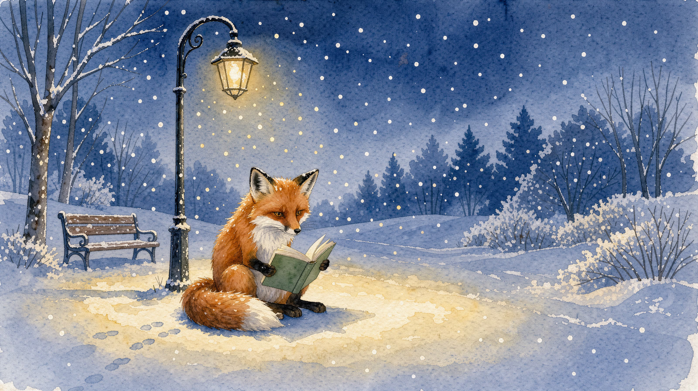
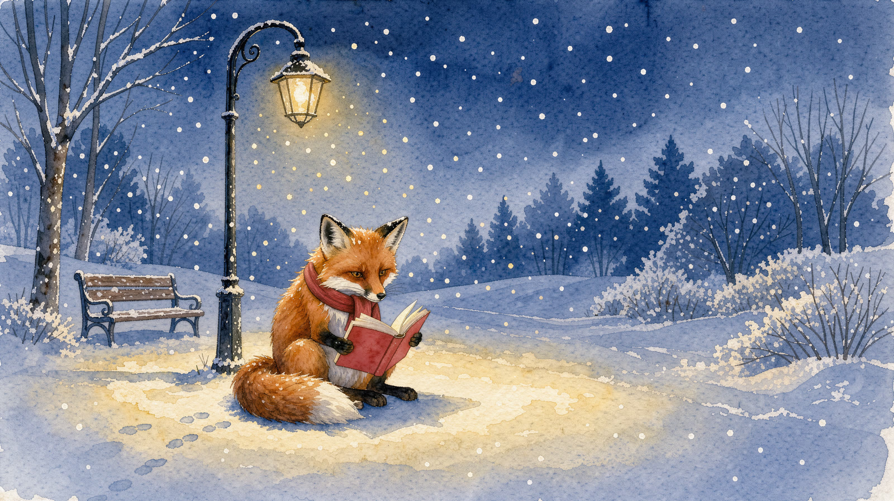

Use this guide when you want Claude Code to make or edit an image for the project you are working on, such as a hero illustration, and save it into the project.

## What you're building

<Frame caption="FLUX 3 Image, 2736×1536, saved to assets/hero.png 55 seconds after one request typed into Claude Code.">

</Frame>

Claude Code has no image model of its own. The OpenRouter MCP server adds tools to it, and this guide uses two of them. `list-models` lets Claude look up image models, their benchmark scores, and the inputs they accept. `generate-image` calls any image model on OpenRouter and bills your OpenRouter account. You type requests in plain English, and Claude calls the tools, saves the file, and updates your code.

By the end, you will have:

1. Connected the OpenRouter MCP server to Claude Code.
2. Generated an image from a plain-English request and added it to a page in your project.
3. Changed part of that image while keeping the rest of the scene.
4. Asked Claude to compare image models on OpenRouter for a specific job.

## Before you start

- Claude Code installed on your machine.
- An OpenRouter account with credits. The walkthrough uses FLUX 3 Image (`black-forest-labs/flux-3-image`); see its [model page](https://openrouter.ai/black-forest-labs/flux-3-image) for pricing, or browse [all image models](https://openrouter.ai/models?output_modalities=image) and the [image generation guide](https://openrouter.ai/docs/guides/overview/multimodal/image-generation).
- A project folder where you want images saved. This guide uses an example folder containing `index.html` for a bookshop called Fox & Lantern Books with a placeholder comment `<!-- hero image goes here: assets/hero.png -->`. Use your own project folder and file paths when you run the steps.
- For full details on the server, see the [OpenRouter MCP server documentation](https://openrouter.ai/docs/guides/overview/mcp-server).

## Step 1: Connect the OpenRouter MCP

From the same project directory you plan to open in Step 2, add the OpenRouter MCP server to Claude Code and sign in through your browser (Claude Code's default local scope registers the server for the current directory, or pass `--scope user` to make it available across projects):

```bash
claude mcp add --transport http openrouter https://mcp.openrouter.ai/mcp
claude mcp login openrouter
```

A consent page opens in your browser where you approve a dedicated key for this connection. The key expires within 7 days and starts with a spend cap that you can edit on the approval screen. You can also authenticate inside an active Claude Code session by running `/mcp`, selecting `openrouter`, and choosing Authenticate. You can disconnect anytime.

Browser sign-in (OAuth) is recommended. If you prefer to use an existing OpenRouter API key instead, pass it as an authorization header (note that your shell expands `$OPENROUTER_API_KEY` into the command's arguments, which can be visible to other local processes on a shared machine):

```bash
claude mcp add --transport http openrouter https://mcp.openrouter.ai/mcp \
  --header "Authorization: Bearer $OPENROUTER_API_KEY"
```

Verify the connection with `claude mcp list`:

```text
Checking MCP server health…

openrouter: https://mcp.openrouter.ai/mcp (HTTP) - ✔ Connected
```

## Step 2: Ask for an image

Open Claude Code in your project folder and ask for the image you need, where to save it, and which file to update. Adapt the file paths and description to your own project:

```text
This landing page needs a hero illustration. Use OpenRouter to generate one: a red fox reading a paperback under a streetlamp on a snowy night, soft watercolor style. Save it to assets/hero.png and add it to index.html.
```

You do not need to name a model or write tool arguments. Claude Code makes these tool calls, in this order:

```text
list-models     output_modalities: image, sort: design-arena-elo-high-to-low, limit: 8
generate-image  model: black-forest-labs/flux-3-image, aspect_ratio: 16:9, resolution: 2K
                prompt: A red fox sitting and reading a paperback book under a glowing streetlamp on a snowy night, soft watercolor style, gentle washes of color, warm lamplight pooling on the snow, deep blue night sky with falling snowflakes, cozy and whimsical, landscape composition
Bash            curl the signed URL into assets/hero.png
Edit            index.html
Read            assets/hero.png
```

Claude looks up image models sorted by Design Arena score, picks `black-forest-labs/flux-3-image`, writes a longer prompt, and chooses a 16:9 aspect ratio for a hero image. The `generate-image` tool returns a link to the image that is valid for 24 hours:

```text
(model: black-forest-labs/flux-3-image, total tokens: 4241)
Signed URL opens without an API key until 2026-11-20T19:16:41.000Z; fetch to view or save, and do not send your API key with it. Anyone with the URL can open the image until it expires, so share it only where the image may go.
```

Claude downloads the image to `assets/hero.png`, edits `index.html`, and opens the saved file to check it against your request. The whole request takes 55 seconds, and Claude replies:

```text
The hero illustration is saved to `assets/hero.png` and added to `index.html`. I generated it with OpenRouter's `black-forest-labs/flux-3-image`.

I opened the saved file to check it. The image is 2736×1536 (16:9). It shows a red fox sitting in a pool of lamplight with an open book, under a snow-dusted streetlamp. The watercolor look comes through well, with a deep blue night sky, falling snow, a park bench and evergreens in the background.

The book is a green hardback rather than a paperback. If you want a paperback, I can regenerate it with a more specific prompt.

In `index.html` I replaced the placeholder comment with this tag:


I haven't committed anything.
```

Image models sometimes add text you did not ask for, such as a title on a book cover or words on a sign. Add "no text" to your request to avoid it.

## Step 3: Change the image

In the same session, ask Claude to change specific parts of the image and overwrite the file:

```text
Nice. Two changes: make the book a paperback with a plain red cover, and give the fox a red scarf. Keep the rest of the picture the same, and save over assets/hero.png.
```

Claude passes the first image's signed URL back to the model in `reference_image_urls` and refers to it as "image 1" in the prompt:

```text
generate-image  model: black-forest-labs/flux-3-image, aspect_ratio: 16:9, resolution: 2K
                reference_image_urls: ["https://storage.googleapis.com/…"]
                prompt: Edit image 1. Make exactly two changes: (1) the book the fox is reading becomes a paperback with a plain red cover, no title or text; (2) the fox wears a red scarf around its neck. Keep everything else identical: the fox's pose and fur, the streetlamp, the glowing lamplight on the snow, the bench, trees, falling snow, blue night sky, soft watercolor style and 16:9 composition.
```

The `reference_image_urls` parameter accepts up to 16 `https` or `data` URLs and works on models that accept image input. The signed link from Step 2 lasts 24 hours, so this works within that time. If Step 2 returned an inline image instead of a link (or after the link expires), pass a `data:` URL from the saved `assets/hero.png` file or host the image at an `https` URL and give that to Claude. If neither is available, stop rather than letting Claude generate a fresh image without the reference.

Claude downloads the edited image to a temporary file, opens it to check it, and replaces `assets/hero.png`. This takes 82 seconds:

```text
I've saved the updated image over `assets/hero.png`. The `` tag in `index.html` already points to that path, so it needed no change.

I generated the new version by passing the first image to the same model (`black-forest-labs/flux-3-image`) as a reference, with instructions to change only the book and the scarf. I opened the result before overwriting the old file:

- **Scarf:** the fox now wears a red scarf wrapped around its neck.
- **Book:** the cover is plain red with no text. It still looks like a small hardback, because the model kept the original book's shape and only recolored it. It isn't a clearly floppy paperback.
- **Everything else:** the pose, lamp, bench, trees, snow, lighting and watercolor style look the same as before.
```

<Frame caption="The same image after one follow-up request. The fox has a red scarf and the book is red. The rest of the scene is unchanged.">

</Frame>

## Step 4: Let Claude choose the model

You can ask Claude to compare models for a job before it generates anything. Looking up models is not billed. Generating an image is.

```text
I need product photos on a plain white background for an online shop. Which image model on OpenRouter should I use? Compare the best few options and recommend one.
```

Claude calls `list-models` twice with `output_modalities: image`, once sorted by `design-arena-elo-high-to-low` and once sorted by `top-weekly`, without calling `generate-image`. In 19 seconds it recommends one model:

```text
For plain-white-background product shots, I'd start with **Google Nano Banana 2.1** (`google/gemini-nano-banana-2.1`).
```

Below that, it lists five models in a table with why each one fits and a caveat for each. It says the shortlist comes from the catalog and not from images of your own products, and it offers to run the top three on a product photo once you agree, because generating is billed.

To use a specific model, name its slug in your request, for example "generate it with google/gemini-nano-banana-2.1".

## How the image reaches your project

The `generate-image` tool returns a link to the image when one can be issued. Otherwise it returns the image itself. The same model can return a link on one request and the image on another, so expect either.

1. A link. The link opens without an API key until it expires. Claude Code downloads it into your project with `curl`.
2. The image itself. Claude Code saves it in its own folder, at `~/.claude/projects/<project>/tool-results/mcp-openrouter-blob-<id>.png`, and then copies it into your project. Copying out of that folder needs your approval. Without it the copy is refused, and Claude prints a `mkdir -p` and `cp` command you can run yourself.

## Troubleshooting

| What you see | Cause | Fix |
|---|---|---|
| `Upstream error HTTP 404: {"error":{"message":"No model found for \"black-forest-labs/flux-3\"","code":404}}` | The slug is misspelled or is not an image model (a chat model slug gives the same error). | Ask Claude to list image models, or copy the slug from the [models page](https://openrouter.ai/models?output_modalities=image). |
| `MCP error -32602: Input validation error: Invalid arguments for tool generate-image: Invalid option: expected one of "1:1"\|"1:2"\|…\|"16:9"\|…\|"auto" at aspect_ratio` | The aspect ratio is not one the tool accepts. | Ask for one of the listed ratios, such as 16:9, 1:1 or 9:16. |
| `Claude requested permissions to edit …/tool-results/mcp-openrouter-blob-….png which is a sensitive file.` | The image came back inline and Claude Code needs approval to copy it out of its own folder. | Approve the copy when asked, or run the `cp` command Claude prints. |
| `{"error":"invalid_token","error_description":"The OpenRouter API rejected this token. Re-authenticate to continue."}` | The connection's key has expired or was removed. | Run `claude mcp login openrouter` again. |

## Check your work

- `claude mcp list` shows `openrouter` as Connected.
- The image file, such as `assets/hero.png`, exists in your project and opens.
- Your page, such as `index.html`, shows the image in a browser.
