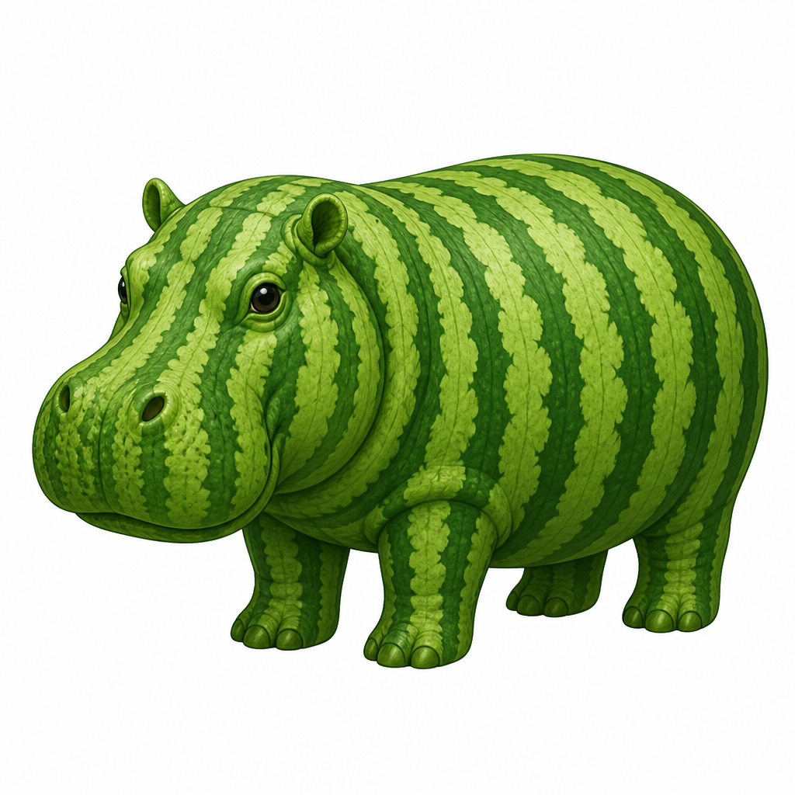
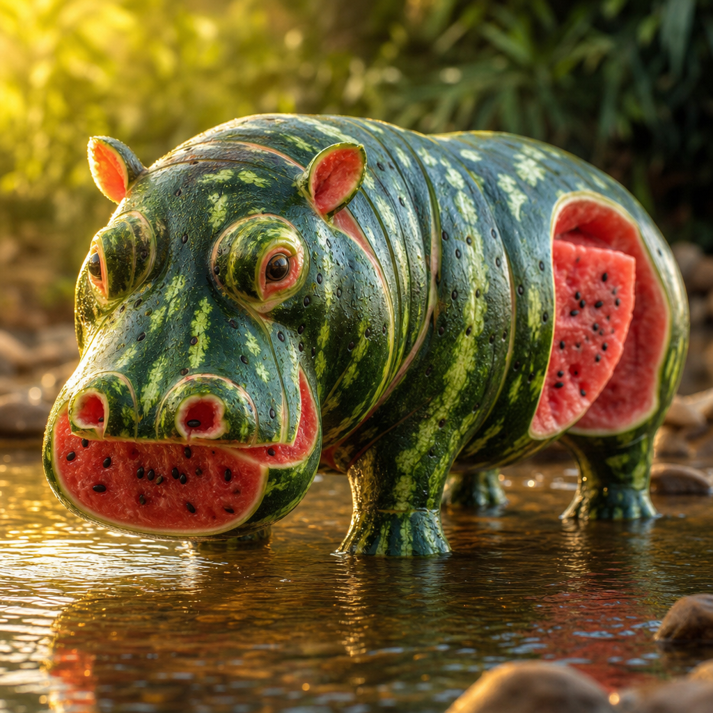

**Goal:** Create a preset that wraps a text model around the `openrouter:image_generation` server tool. The text model rewrites vague user requests into detailed image prompts, then calls the tool. You get better images from a single API call.

**Outcome:** A reusable preset slug (`@preset/your-slug`) that any app can call like a model. The user sends "make a watermelon hippo," and the text model crafts a detailed visual description (materials, lighting, composition, style) before generating the image.

## Before you start

You need:

- An OpenRouter API key (for creating the preset and making requests)
- A decision on which text model orchestrates (rewrites prompts) and which image model generates

Use these references for exact schemas:

- [Presets feature](/guides/features/presets)
- [Image generation server tool](/guides/features/server-tools/image-generation)
- [Available image models](https://openrouter.ai/models?output_modalities=image)

<Warning>
Each request through this preset makes two model calls: one to the text model (for prompt refinement) and one to the image model (for generation). The text model call is cheap; the image generation cost depends on the image model you configure. Check pricing on the [image model's page](https://openrouter.ai/models?output_modalities=image) before routing production traffic.
</Warning>

## How the pattern works

A standard image generation call looks like this: your user says "make a watermelon hippo," and the image model gets exactly that. The result is decent but literal, because the image model has no creative direction.

The difference is visible. Here's the same concept, with and without prompt enhancement:

| Bare prompt: "make a watermelon hippo" | Preset-enhanced prompt |
|---|---|
|  |  |

The bare prompt produces a literal interpretation. The preset's orchestrator expands it into a detailed scene with materials, lighting, and environment before the image model touches it.

The preset pattern inserts a text model as an orchestrator:

1. User sends "make a watermelon hippo" to `@preset/your-slug`
2. The text model (guided by your system prompt) rewrites it into something like: "A photorealistic hippopotamus sculpted entirely from watermelon rind and flesh, dark green outer rind with lighter stripes forming the body, exposed sections revealing vibrant pink-red watermelon flesh, black seeds dotting the surface like natural skin texture, standing in a shallow river at golden hour, warm sunlight catching water droplets on the glossy rind"
3. The text model calls `openrouter:image_generation` with the enhanced prompt
4. OpenRouter generates the image and returns the URL to the text model
5. The text model responds with the image and (optionally) explains what it created

The text model handles the creative interpretation. The image model handles the rendering. Each does what it's best at.

## Step 1: Create the preset via API

The fastest way to create the preset is to POST a [Responses API](/api_reference/responses/overview) request body to the preset creation endpoint, authenticated with a read-write [management key](/guides/overview/auth/management-api-keys). This captures the model, system prompt (`instructions`), tools, and parameters in one call:

```bash expandable lines
curl https://openrouter.ai/api/v1/presets/image-enhancer/responses \
  -H "Authorization: Bearer $OPENROUTER_MANAGEMENT_KEY" \
  -H "Content-Type: application/json" \
  -d '{
    "model": "anthropic/claude-opus-4.8",
    "instructions": "You are an expert visual prompt engineer. When the user asks you to create an image, analyze their request and expand it into a detailed image generation prompt. Cover: subject and action, composition and framing, lighting and atmosphere, color palette, artistic style or medium, and mood. Then call the image generation tool with your enhanced prompt. Keep explanations brief; prioritize the image.",
    "tools": [
      {
        "type": "openrouter:image_generation",
        "parameters": {
          "model": "google/gemini-3.1-flash-image"
        }
      }
    ],
    "tool_choice": "required",
    "temperature": 0.7
  }'
```

The response confirms your preset was created:

```json expandable lines
{
  "data": {
    "id": "650e8400-e29b-41d4-a716-446655440001",
    "creator_user_id": "user_2dHFtVWx...",
    "name": "image-enhancer",
    "slug": "image-enhancer",
    "status": "active",
    "designated_version": {
      "id": "550e8400-e29b-41d4-a716-446655440000",
      "preset_id": "650e8400-e29b-41d4-a716-446655440001",
      "version": 1,
      "system_prompt": "You are an expert visual prompt engineer...",
      "config": {
        "model": "anthropic/claude-opus-4.8",
        "tools": [
          {
            "type": "openrouter:image_generation",
            "parameters": { "model": "google/gemini-3.1-flash-image" }
          }
        ],
        "tool_choice": "required",
        "temperature": 0.7
      },
      "created_at": "2026-06-24T12:00:00Z"
    }
  }
}
```

<Info>
The response shown above is abbreviated. The full response includes additional fields like `workspace_id`, `description`, and timestamps. See the [Presets API reference](/client-sdks/typescript/sdks/presets/README) for the complete schema.
</Info>

You can also create or edit presets from the [Presets dashboard](https://openrouter.ai/settings/presets), which has a visual server tools editor.

## Step 2: Use the preset

Send requests to your preset slug as if it were a model:

<CodeGroup>

```bash lines
curl https://openrouter.ai/api/v1/responses \
  -H "Authorization: Bearer $OPENROUTER_API_KEY" \
  -H "Content-Type: application/json" \
  -d '{
    "model": "@preset/image-enhancer",
    "input": "A cozy bookshop on a rainy evening"
  }'
```

```typescript title="TypeScript" lines
const response = await fetch('https://openrouter.ai/api/v1/responses', {
  method: 'POST',
  headers: {
    Authorization: `Bearer ${process.env.OPENROUTER_API_KEY}`,
    'Content-Type': 'application/json',
  },
  body: JSON.stringify({
    model: '@preset/image-enhancer',
    input: 'A cozy bookshop on a rainy evening',
  }),
});

const data = await response.json();
console.log(JSON.stringify(data, null, 2));

```

```python title="Python" lines
import os
import json
import requests

response = requests.post(
    "https://openrouter.ai/api/v1/responses",
    headers={
        "Authorization": f"Bearer {os.environ['OPENROUTER_API_KEY']}",
        "Content-Type": "application/json",
    },
    json={
        "model": "@preset/image-enhancer",
        "input": "A cozy bookshop on a rainy evening",
    },
)

data = response.json()
print(json.dumps(data, indent=2))

```

```go title="Go" lines
package main

import (
	"fmt"
	"io"
	"log"
	"net/http"
	"os"
	"strings"
)

func main() {
	body := strings.NewReader(`{
  "model": "@preset/image-enhancer",
  "input": "A cozy bookshop on a rainy evening"
}`)
	req, _ := http.NewRequest("POST", "https://openrouter.ai/api/v1/responses", body)
	req.Header.Set("Authorization", "Bearer "+os.Getenv("OPENROUTER_API_KEY"))
	req.Header.Set("Content-Type", "application/json")

	resp, err := http.DefaultClient.Do(req)
	if err != nil {
		log.Fatal(err)
	}
	defer resp.Body.Close()
	out, _ := io.ReadAll(resp.Body)
	fmt.Println(string(out))
}

```

</CodeGroup>

```text title="Output"
{
  "id": "gen-1795431930-t1weAyOLGPwHPlZIG32i",
  "object": "response",
  "created_at": 1795431930,
  "model": "anthropic/claude-opus-4.8",
  "status": "completed",
  "completed_at": 1795431954,
  "output": [
    {
      "type": "openrouter:image_generation",
      "id": "st_tmp_ka6tvo1k7vn",
      "status": "completed",
      "result": "
…[192000 chars clipped]…
Or6+v69i7PdWCTOxymsPXr0xM1T6n4bHg6HNBSDq+DmcO3NzLZS0jjkqZSom8JP9kNmDEnHpA/vnsPbfDy6ewQQHMrucDXP83qY2+GwHZY1IJQkkqmZnZI6gl7XJWm/PJoIE8XhJaekQigkHY4bUkJPryCFtylabk4JCIlISgJO93ACAQRJICnv370zKiSMFLO6LJt7IJBSCgkGW7NqJpIIiIAeAFSoSRGOiGEcREQ1haCZw5FyWet2fZj7t3z86cthOgFZA25mwfP92c31Tc6DwyXJPK+i2rb15vpmN43eLGw7m4b9oCf7EfR7FydJ6K05HBa1bghRylDGrVXvFXw9ummOcA26Oens5xdU1dqag4d5Xrd121pEiOo0lH7CCDTfqm1moarm0JITddvazbz86le/+vG//3QcJ+/qdc4BaCrujRF13cowdHCvKtWbkpqYkkR4OOjIKeeU52UpZQj31Js/U6q1XHrlF5/GKUlet1q3jSoE3aOU4mERTmGSdDweh3FcluX16ythiMjjh4+2bT0eDhDxQI+bLUNKKZ2fnl9eXm1rPRyXq5vLr/3h10X0g2cfXL6+/M9/8Re/+uWvP3728bibXl1e5qI380E1vfj0xZ07p6VollzXtbYWHuNUxmFc5u3m+uZwc5znBeC9uxdjGl69erks9Qtf+NI4TD//2c+ur163uuyn6XPv/YGZX16+BkB2mq3hDoqquCA8zL25iSQVjRBzT9LpFimw1tydIQxTVXogvNYGyi1haOYI1YS+pSPoUXIW0szCwztODIRDRM9OT5d5WZbNzU9PTocy1K0NJeWUzKtoWrcVIs08UcYyjMN4nI8INPrp6b5u9fpw8+TR4+ury3AfSi8uk1uzQPTcqW1dA0gpDcPYmrm55iRgrZuqUpiStG0tORMhmpKmdZ3dGpXmePbs+bwuuyxf/vy7iNXbZmG1tpzSfpqSprqu3uq8Lilpa03Jnp5V2zofl7PzczPz1gDuduO0m9Z1OdntILEuMwLTNAxjOT3df/rJs1jaj/7pB+ty8+bTJ+42lCGXAQRAMyvDILnkYcyp5KwR1tZl25awpsIskkqK6Jo8n7/49Or1YZ7nzLhzfrLf5WkQCXv9+qqZPnv2PDymabxzNrz99lMVub45bC3CNYJbr1+gwgDcSsL5brx/thsVddlEZavNAzXMIqzFtlWLENGU1NzJEIQoUu8rzK7rwSJ67w9J2mF6LoOQFqAEIgA43KMJRUUpYtEdTez5WaRK7+ipCspaW8/XkNtcSCDACJUOmhF+GysZCFV2RQwRDBdhFyhEWPII0gPWPAAym4cHamvowQoCpaI7JtyVEnQGlWLWKKRAGQQRcQvAFELknsIRZAQBEQ1EJ1foYB1UsP8ebh3ZkR3lq6a01SqSttrmalTdanNIWEvac5Q3iRbbusw3SQTkMA4pF49w7xTOPUKydjjszbZtbRaa1NyOh8Myr6ATzCmZm4ApZQVvPbgiImgR7k3Ye9wKQYckkfBwdvwkHexRhP/hQqSgm9qgu9EpIiLJGQh493MCQYJ0t7AA6RHhCmEzAwNAtWoRACNoZt7rqfP2EQNWl6uvfeW9p0/uUNNf/e2PPn5+LXnYlsPXv/ru3bunmkv19N/+7+9ZDCFEeHi7c1r+7DtfCWuvrrd//Kf/cf/BO69e3/zoh//87W9/u4zSTP/u+/9aG9zaH7z79MtfeBPAT37+4a9+84EyvvntP7xzkkPk73/w4zLsRcqHH37yy/d/+8nHL+ZlOd9PX/3yu9tyYxG7cfjT737z1atPf/P+h+NuD0JUOIoVAAAgAElEQVRIb6GiRCgREBVJIq01pQoDARCqKqpZNRwl57q1QES4WSRVzZJy1pzNnBARTZJq6+4KBCLnUjR7hCEiIsxARG2tNoR3dUk1t3Zbun8cx1RKcwt3CkIgSba6dbobCCKE9GZdVl7XtZkNeRiHaZ4Pc1vrVltrdy4uNJW6bVvE6fm5uzdrSqWgqJKCoIdXMxUh2NwIEAQkJRXJ1ixE3b1XW1BRERIQVWoO9wg0d5hd39wA0O4TBEMoqhrQNJhbeCiTqgb7sSQjSIhIykNKOWi9CB2IzVZ315ypGQzVpBSSfW+XPLRmrTX2/coAeKsVgkEPg3QNjmT/KxGEijghKh5dbvL9bq85l3FSzZ+FAwTJIAIg2a3Z7e8EAoEQsvMagB5OiodrTkMp27Z51/scJN3RaXxERAACFdntdttW13UV0hEURr+bSY8AAcARJPtp7ozQI0SUPdGJgj6FCABBJwiBO1J3NdVm7gSCiAhHEABAAqAKyb4Rw8NF+jSRZESAfcAgiAhIN4YMIOAgheLuEGpK4QCCEIoIhAQp4RHinZo5EQZSmzWCJPrnuIWISGLJAwhF0p4TqhBSklLFzdCZAEWSUiCiEWjWfNu2dV2XA8P9VmthAHAHEO4EEBGI/7iJbgUcobn3mU+kwQlMwxi1URCBVqtH5JRas3Wt1BThKSUt40iiblU1iaqbuVkPE6pbEwjQl1M8eoITRCiqSZOD7oGIlLKSEeFuHu4BTTpMO7Nu6HuxfIBs7lDxcK8e7sTt8uScVZP3Orq3QR8RESKiwggHkDUrsG6LbfNuGhXhEV3v0JSttSFng4tIsD8O2L8Vtxl1ICh95wEBqhChQoaHm1DQSZOKuzdzdxdhEt5uFghFgxLQrdZ1WyNISt8T0uummG11CzeAQoJqbpqGu/fuU1NzQlQ1j9Okkrdtgzd6rce5rjOtkaCouXVrAmr0LSB9/8bthnZHwD12u5P92WmEGDiOO6GYtbqtbdusrm2bSVdE1gS4exMRxK217rFt7k0YKWmS26qzKgJ3FZFEByFaDfPaTFVSDsDMEGFhWdV9y1H3yd99dPfLbz/apdiJEP7y5SumYbc/Yx7O7t5bW1DS/vRcQh4+fHCYD2MZ11pVuB5url88HxPg7fry9XK8AVhbvTg/ySk/e/bJ40cPL1++/ujZhyenJzmVq+ubz3/xCwosx+Pp6Z2z83OVfLg+pDI8ePjg5z//xc3NdS6lNX95eZXzOC/rcLLvVHZdFhEdh3y4uYmInGVb591uvLhz0ptBTGOZdmNOvHfnLGoVd0S1trlvY06n0zRknIxlGvJyvMmI09M96PPNzZRlmefLy9ellHt37756+eKT55/kIQni8ura3VX1vc+99/yTT9zju9/9UwK/++37n//8H5ydnX38/KVqefPNt5ZlAXxd5/n66o+++uXl+urJk0dmfjgc9ye7168vW7Xz8zsQHg43bd0u7lxY2FCGlGWZj3XbBDg/3V++fpnJ05NdJhiWkpSS9mOp27obRm/blEcJbmbzvKzLuiz19eUhRNa1hmitrilvaxvKuG212QZj3SqEJ9O+ZFnnjarw/PrqIJrCo5oDIQF3U1WlioqZRQSDkqTWJiJJtZuClFTC7p6f7odEWM55q1vXGlLOKScPt7DjshEAmXMqkoQMRilFRKap7HdTLsktluWoKbVaU8q9I2xEjGVctjqN+6vr66vrQx6mYZpevbw8znMuU/P24uWr2uo4TJeX18OQp2GwVg+Hy904JOLq6rLW9exk2k0Tmp2fnChCYNbafpqWdUY3/bgtkYMIkl21HIbiiFyyajKzcORcgu5+W35yXRazui4r4BExToN7MLjb79Z1y3kgYl1mkHfu3FvWenF2TsiybNVsqzWXsq6NYLPY7aZtXUlGeGvNzXIpiQKP2myaxpLLtm3V2jSNQszzHB4dIU3TYOYQEXA37czqum0MRTDn1Jo3qzmnIee6rdtWp3G8uLioaz07P7t39+L68tXxeNjWqiWnLK+vrlUlp3R6up/nubV2dn7erdfjN5/8/Be/+PjZJ1/9ytdPTk9/9KN/Vk0ffPBBKeXizkXJQ20tJb1//z4ZN68vNeW33n7zcDy+ev1SVMexvHjxmsT5yenl9dV+v3/48NHh5jCWsdb6xhtvXL66dG/3H9xb50VEUs7zv
```

The text model receives your message, crafts a detailed prompt, calls the image generation tool, and returns the result. Your application code doesn't know or care about the orchestration happening inside.

## What comes back

The response looks like a normal Responses API response. The `output` array has an `openrouter:image_generation` item with the generated image in `result` and the enhanced `prompt` the text model wrote, followed by the text model's `message` with any commentary it added:

```json expandable lines
{
  "id": "gen-...",
  "object": "response",
  "model": "anthropic/claude-opus-4.8",
  "status": "completed",
  "output": [
    {
      "type": "openrouter:image_generation",
      "id": "st_...",
      "status": "completed",
      "result": "data:image/png;base64,iVBORw0KGgo...",
      "imageUrl": "data:image/png;base64,iVBORw0KGgo...",
      "prompt": "A cozy bookshop on a rainy evening, warm golden light glowing from inside, wooden shelves filled with colorful books, a large window with raindrops trickling down..."
    },
    {
      "type": "message",
      "id": "msg_...",
      "role": "assistant",
      "status": "completed",
      "content": [
        {
          "type": "output_text",
          "text": "Here's your cozy bookshop scene: a warm, inviting independent bookstore viewed through a rain-streaked window, with golden light spilling onto wet cobblestones.",
          "annotations": []
        }
      ]
    }
  ],
  "usage": {
    "input_tokens": 1996,
    "output_tokens": 174,
    "total_tokens": 2170,
    "cost": 0.0010768,
    "server_tool_use_details": { "tool_calls_requested": 1, "tool_calls_executed": 1 }
  }
}
```

Save the image from `result` if you need it long-term.

## Customization

### Choosing the orchestrator model

The orchestrator rewrites prompts and decides when/how to call the tool. Good picks:

| Priority | Model | Why |
|----------|-------|-----|
| Speed + cost | `openai/gpt-4.1-mini` | Fast, cheap, good at instruction following |
| Creative quality | `~anthropic/claude-sonnet-latest` | Strong at nuanced creative interpretation |
| Maximum quality | `anthropic/claude-opus-4.8` | Best creative reasoning in the Opus family, 1M context |

The orchestrator cost is typically small (a few hundred tokens of prompt rewriting). The image generation cost dominates.

### Choosing the image model

Configure the image model in the tool's `parameters.model` field. [`google/gemini-3.1-flash-image`](https://openrouter.ai/google/gemini-3.1-flash-image) (Nano Banana 2) is a strong default: fast, cheap ($0.50/M input), and high quality. See [available image models](https://openrouter.ai/models?output_modalities=image) for all current options and pricing.

### Tuning the system prompt

The system prompt controls how aggressively the orchestrator rewrites. Some patterns:

- **Faithful expansion**: "Expand the user's request with visual detail while preserving their stated intent. Don't override their style choices."
- **Brand-consistent**: "All images should use our brand palette (navy #1a1a2e, gold #e6b800, cream #faf0e6). Apply a clean, modern illustration style."
- **Domain-specific**: "You are generating product photography prompts. Focus on lighting setup, background material, camera angle, and product placement."

### Image tool parameters

The tool's `parameters` object accepts `model` plus all `image_config` fields (quality, aspect_ratio, size, background, output_format, output_compression, moderation). See the [image generation server tool reference](/guides/features/server-tools/image-generation) for the full list and model-specific defaults.

### Using different image models for different scenarios

The image model is fixed per preset (the orchestrator can't switch it mid-request). Create separate presets for different quality tiers and let your application pick the right one.

## Updating the preset without redeploying

One of the key benefits: change the image model, tune the system prompt, or adjust parameters from the [Presets dashboard](https://openrouter.ai/settings/presets) or via the API. No code deploy needed. Your application keeps calling `@preset/image-enhancer` and picks up the new config immediately.

To create a new version via API, POST to the same endpoint again with your updated config. The latest version becomes active automatically.

## Next steps

- Explore [available image models](https://openrouter.ai/models?output_modalities=image) and compare pricing, quality, and speed
- Read about [presets](/guides/features/presets) for version management, team sharing, and the preset field merge behavior
- Use the [OpenRouter TypeScript SDK](/sdks/typescript) or [Python SDK](/sdks/python) for typed preset interactions in your app
- Add [web search](/guides/features/server-tools/web-search) to the preset's tools so the orchestrator can reference current visual trends or specific art styles
- Track image generation costs with the [Analytics guide](/cookbook/administration/analytics-cost-control) to monitor per-preset spend
- Handle multi-turn conversations where the user refines images iteratively (pass previous turns in `input` to the preset to maintain context)
