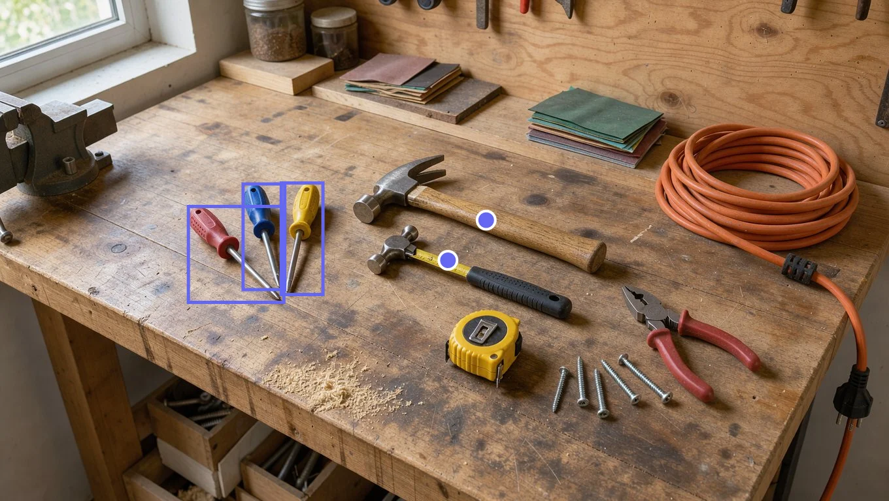

Use this guide when you need to know where something is in an image, not only whether it is there: to count items, crop them out, check a shelf or a workbench, or tell an agent where to click.

## What you're building

<Frame caption="Boxes around every screwdriver and a point on each hammer, from two requests to Moondream 3.1. Each request took under two seconds.">
  
</Frame>

Moondream models answer two slash commands in an ordinary [Responses API](/api_reference/responses/overview) request. Start the text of a user message with `/detect {"object":"screwdriver"}` and the model returns a bounding box for every match. Start it with `/point {"object":"hammer"}` and it returns one point per match. Both come back as JSON in the `output_text` part of the `message` output item, with coordinates from 0 to 1 relative to the image, so you need no detection API, schema, or prompt engineering.

By the end, you will have a script that:

1. Asks for bounding boxes around one kind of object.
2. Asks for a point on each instance of another.
3. Draws the boxes and points on the photo and saves it as a PNG.

<Tip>
  Building with a coding agent? Paste the URL of this page into Claude Code, Codex, or Cursor and ask it to highlight the objects a user types in over the photo they upload, using this recipe.
</Tip>

## Before you start

You need:

- An OpenRouter API key available as `OPENROUTER_API_KEY`
- Bun, or Node.js 22.18 or newer (both run TypeScript files directly)
- `sharp` to load and draw on the image: `npm install sharp`
- For the Go tabs, Go 1.21 or newer in place of Node.js and `sharp`. They use only the standard library.
- A JPEG, PNG, WebP, or GIF photo. The Go tabs read JPEG, PNG, and GIF only, because the standard library has no WebP decoder, so convert a WebP photo first. To follow along exactly, download the [workbench photo](/assets/cookbook/image-understanding/find-objects-in-images/workbench.jpg) used on this page and save it as `workbench.jpg`.

This guide uses `moondream/moondream3.1-9b-a2b`. `moondream/moondream3-preview` takes the same commands. See the [Moondream 3.1](https://openrouter.ai/moondream/moondream3.1-9b-a2b) model page for pricing, and [Image Understanding](/guides/overview/multimodal/image-understanding) for the ways to send images.

## Step 1: Find every match with /detect

Create `find-objects.ts`. The `loadImage` helper turns the photo upright and reads its format: Moondream reads the stored pixels and ignores the EXIF orientation tag that phone cameras set, so a phone photo would otherwise come back with coordinates for a sideways image. The Go tab is the exception: its `loadImage` reads the size and format but does not rotate anything, so turn a phone photo upright in an image editor before you pass it in, or the coordinates describe the sideways image. The `locate` helper sends one image and one command, and returns the array of matches. The command must be the first thing in the text part, and its argument must be a JSON object with an `object` key.

<CodeGroup>

```ts expandable lines
import sharp from "sharp";

const apiKey = process.env.OPENROUTER_API_KEY;
if (!apiKey) throw new Error("Set OPENROUTER_API_KEY first.");

const MODEL = "moondream/moondream3.1-9b-a2b";

type Box = { x_min: number; y_min: number; x_max: number; y_max: number };
type Point = { x: number; y: number };
type Image = { data: Buffer; mime: string; width: number; height: number };

const MIME_TYPES: Record<string, string> = {
  jpeg: "image/jpeg",
  png: "image/png",
  webp: "image/webp",
  gif: "image/gif",
};

async function loadImage(imagePath: string): Promise<Image> {
  const { data, info } = await sharp(imagePath)
    .autoOrient()
    .toBuffer({ resolveWithObject: true });
  const mime = MIME_TYPES[info.format];
  if (!mime) {
    throw new Error(`Unsupported image format: ${info.format}. Use JPEG, PNG, WebP, or GIF.`);
  }
  return { data, mime, width: info.width, height: info.height };
}

async function locate(
  image: Image,
  skill: "detect" | "point",
  object: string,
): Promise<unknown[]> {
  const response = await fetch("https://openrouter.ai/api/v1/responses", {
    method: "POST",
    headers: {
      Authorization: `Bearer ${apiKey}`,
      "Content-Type": "application/json",
    },
    body: JSON.stringify({
      model: MODEL,
      input: [
        {
          role: "user",
          content: [
            { type: "input_text", text: `/${skill} ${JSON.stringify({ object })}` },
            {
              type: "input_image",
              image_url: `data:${image.mime};base64,${image.data.toString("base64")}`,
              detail: "auto",
            },
          ],
        },
      ],
    }),
  });

  if (!response.ok) throw new Error(await response.text());

  const result = await response.json();
  const content: string = result.output
    .find((item: { type: string }) => item.type === "message")
    .content.find((part: { type: string }) => part.type === "output_text").text;
  const key = skill === "detect" ? "objects" : "points";
  const matches = JSON.parse(content)[key];
  if (!Array.isArray(matches)) {
    throw new Error(`Expected "${key}" in the response, got: ${content}`);
  }
  return matches;
}

const image = await loadImage(process.argv[2] ?? "workbench.jpg");

const objects = (await locate(image, "detect", "screwdriver")) as Box[];
console.log(`detect screwdriver: ${objects.length} boxes`);
console.log(JSON.stringify(objects, null, 2));
```

```go title="Go" lines
package main

import (
	"bytes"
	"encoding/base64"
	"encoding/json"
	"fmt"
	"image"
	_ "image/gif"
	_ "image/jpeg"
	_ "image/png"
	"io"
	"log"
	"net/http"
	"os"
)

const model = "moondream/moondream3.1-9b-a2b"

type Image struct {
	Data          []byte
	Mime          string
	Width, Height int
}

var mimeTypes = map[string]string{
	"jpeg": "image/jpeg",
	"png":  "image/png",
	"gif":  "image/gif",
}

// loadImage reads the photo and its format. The Go standard library does not
// apply EXIF orientation, so rotate phone photos upright before using them.
// It also has no WebP decoder, so this tab accepts JPEG, PNG, and GIF only.
func loadImage(path string) (Image, error) {
	data, err := os.ReadFile(path)
	if err != nil {
		return Image{}, err
	}
	cfg, format, err := image.DecodeConfig(bytes.NewReader(data))
	if err != nil {
		return Image{}, err
	}
	mime, ok := mimeTypes[format]
	if !ok {
		return Image{}, fmt.Errorf("unsupported image format: %s. Use JPEG, PNG, or GIF", format)
	}
	return Image{data, mime, cfg.Width, cfg.Height}, nil
}

func locate(apiKey string, img Image, skill, object string) ([]any, error) {
	arg, _ := json.Marshal(map[string]string{"object": object})
	body, _ := json.Marshal(map[string]any{
		"model": model,
		"input": []any{map[string]any{
			"role": "user",
			"content": []any{
				map[string]any{"type": "input_text", "text": "/" + skill + " " + string(arg)},
				map[string]any{
					"type":      "input_image",
					"image_url": "data:" + img.Mime + ";base64," + base64.StdEncoding.EncodeToString(img.Data),
					"detail":    "auto",
				},
			},
		}},
	})

	req, _ := http.NewRequest("POST", "https://openrouter.ai/api/v1/responses", bytes.NewReader(body))
	req.Header.Set("Authorization", "Bearer "+apiKey)
	req.Header.Set("Content-Type", "application/json")
	resp, err := http.DefaultClient.Do(req)
	if err != nil {
		return nil, err
	}
	defer resp.Body.Close()
	raw, _ := io.ReadAll(resp.Body)
	if resp.StatusCode >= 300 {
		return nil, fmt.Errorf("%s", raw)
	}

	var result struct {
		Output []struct {
			Type    string `json:"type"`
			Content []struct {
				Type string `json:"type"`
				Text string `json:"text"`
			} `json:"content"`
		} `json:"output"`
	}
	if err := json.Unmarshal(raw, &result); err != nil {
		return nil, err
	}
	content := ""
	for _, item := range result.Output {
		if item.Type == "message" {
			for _, part := range item.Content {
				if part.Type == "output_text" {
					content = part.Text
				}
			}
		}
	}

	key := "points"
	if skill == "detect" {
		key = "objects"
	}
	var parsed map[string]any
	json.Unmarshal([]byte(content), &parsed)
	matches, ok := parsed[key].([]any)
	if !ok {
		return nil, fmt.Errorf("expected %q in the response, got: %s", key, content)
	}
	return matches, nil
}

func main() {
	apiKey := os.Getenv("OPENROUTER_API_KEY")
	if apiKey == "" {
		log.Fatal("Set OPENROUTER_API_KEY first.")
	}

	path := "workbench.jpg"
	if len(os.Args) > 1 {
		path = os.Args[1]
	}
	img, err := loadImage(path)
	if err != nil {
		log.Fatal(err)
	}

	objects, err := locate(apiKey, img, "detect", "screwdriver")
	if err != nil {
		log.Fatal(err)
	}
	fmt.Printf("detect screwdriver: %d boxes\n", len(objects))
	out, _ := json.MarshalIndent(objects, "", "  ")
	fmt.Println(string(out))
}

```

</CodeGroup>

Run it with `bun find-objects.ts` or `node find-objects.ts`. For the Go tab, save it as `find-objects.go` and run `go run find-objects.go`. With the workbench photo, it prints:

```text lines
detect screwdriver: 3 boxes
[
  {
    "x_min": 0.2119140625,
    "y_min": 0.41162109375,
    "x_max": 0.3193359375,
    "y_max": 0.60400390625
  },
  {
    "x_min": 0.27734375,
    "y_min": 0.36865234375,
    "x_max": 0.32421875,
    "y_max": 0.57666015625
  },
  {
    "x_min": 0.3125,
    "y_min": 0.3671875,
    "x_max": 0.359375,
    "y_max": 0.58984375
  }
]
```

Each box is the top-left (`x_min`, `y_min`) and bottom-right (`x_max`, `y_max`) corner as a fraction of the image width and height, measured from the top-left of the image. When nothing matches, the model returns `{"objects": []}`.

The `object` value can be a short description as well as a noun. `{"object":"red-handled screwdriver"}` returns one box, around the red one only.

## Step 2: Mark each match with /point

`/point` returns one point on each match instead of a box, which is all you need to count things or to pass a click target to an agent. Add these lines to the end of the script:

<CodeGroup>

```ts lines
const points = (await locate(image, "point", "hammer")) as Point[];
console.log(`point hammer: ${points.length} points`);
console.log(JSON.stringify(points, null, 2));
```

```go title="Go" lines
	points, err := locate(apiKey, img, "point", "hammer")
	if err != nil {
		log.Fatal(err)
	}
	fmt.Printf("point hammer: %d points\n", len(points))
	out, _ = json.MarshalIndent(points, "", "  ")
	fmt.Println(string(out))

```

```python title="Python" lines
points = locate(image, "point", "hammer")
print(f"point hammer: {len(points)} points")
print(json.dumps(points, indent=2))

```

</CodeGroup>

```text lines
point hammer: 2 points
[
  {
    "x": 0.54296875,
    "y": 0.4375
  },
  {
    "x": 0.50390625,
    "y": 0.5234375
  }
]
```

## Step 3: Draw the results on the image

Multiply the fractions by the image size to get pixels, build an SVG with a rectangle per box and a circle per point, and let `sharp` lay it over the photo. Add this to the end of the script:

<CodeGroup>

```ts expandable lines
const { width, height } = image;

const rects = objects.map((b) => {
  const x = b.x_min * width;
  const y = b.y_min * height;
  const w = (b.x_max - b.x_min) * width;
  const h = (b.y_max - b.y_min) * height;
  return `<rect x="${x}" y="${y}" width="${w}" height="${h}" fill="none" stroke="#6467f2" stroke-width="5"/>`;
});

const dots = points.map(
  (p) =>
    `<circle cx="${p.x * width}" cy="${p.y * height}" r="14" fill="#6467f2" stroke="white" stroke-width="4"/>`,
);

const overlay = Buffer.from(
  `<svg width="${width}" height="${height}" xmlns="http://www.w3.org/2000/svg">${rects.join("")}${dots.join("")}</svg>`,
);

await sharp(image.data)
  .composite([{ input: overlay }])
  .png()
  .toFile("annotated.png");

console.log(`Saved annotated.png (${width}x${height})`);
```

```go title="Go" lines
	width, height := float64(img.Width), float64(img.Height)

	var svg strings.Builder
	fmt.Fprintf(&svg, `<svg width="%d" height="%d" xmlns="http://www.w3.org/2000/svg">`, img.Width, img.Height)
	fmt.Fprintf(&svg, `<image href="data:%s;base64,%s" width="%d" height="%d"/>`,
		img.Mime, base64.StdEncoding.EncodeToString(img.Data), img.Width, img.Height)

	for _, o := range objects {
		b := o.(map[string]any)
		x := b["x_min"].(float64) * width
		y := b["y_min"].(float64) * height
		w := (b["x_max"].(float64) - b["x_min"].(float64)) * width
		h := (b["y_max"].(float64) - b["y_min"].(float64)) * height
		fmt.Fprintf(&svg, `<rect x="%g" y="%g" width="%g" height="%g" fill="none" stroke="#6467f2" stroke-width="5"/>`, x, y, w, h)
	}

	for _, p := range points {
		pt := p.(map[string]any)
		fmt.Fprintf(&svg, `<circle cx="%g" cy="%g" r="14" fill="#6467f2" stroke="white" stroke-width="4"/>`,
			pt["x"].(float64)*width, pt["y"].(float64)*height)
	}
	svg.WriteString("</svg>")

	if err := os.WriteFile("annotated.svg", []byte(svg.String()), 0o644); err != nil {
		log.Fatal(err)
	}

	fmt.Printf("Saved annotated.svg (%dx%d)\n", img.Width, img.Height)
```

```python title="Python" lines
width, height = image.width, image.height

rects = []
for b in objects:
    x = b["x_min"] * width
    y = b["y_min"] * height
    w = (b["x_max"] - b["x_min"]) * width
    h = (b["y_max"] - b["y_min"]) * height
    rects.append(f'<rect x="{x}" y="{y}" width="{w}" height="{h}" fill="none" stroke="#6467f2" stroke-width="5"/>')

dots = [
    f'<circle cx="{p["x"] * width}" cy="{p["y"] * height}" r="14" fill="#6467f2" stroke="white" stroke-width="4"/>'
    for p in points
]

# Embed the photo in the SVG so the overlay sits on top of it.
photo = f"data:{image.mime};base64,{base64.b64encode(image.data).decode()}"
svg = (
    f'<svg width="{width}" height="{height}" xmlns="http://www.w3.org/2000/svg">'
    f'<image href="{photo}" width="{width}" height="{height}"/>'
    f'{"".join(rects)}{"".join(dots)}</svg>'
)

with open("annotated.svg", "w") as f:
    f.write(svg)

print(f"Saved annotated.svg ({width}x{height})")

```

</CodeGroup>

```text lines
Saved annotated.png (1360x768)
```

Open `annotated.png` to see the image at the top of this page. The Go version has no `sharp`, so it embeds the photo in the SVG and saves `annotated.svg` instead. To crop a match out instead of drawing it, pass the same pixel values to `sharp(image.data).extract({ left: x, top: y, width: w, height: h })`, rounded to whole numbers.

## Troubleshooting

Moondream returns the same error for every malformed command: `Provider returned error`, with `"message":"Invalid request."` inside `error.metadata.raw`.

| Error | Cause | Fix |
|---|---|---|
| `Invalid request.` | The argument is plain text, such as `/detect screwdriver` | Send a JSON object: `/detect {"object":"screwdriver"}` |
| `Invalid request.` | The key is not `object`, or the value is an array | Use one `object` string per request, and send one request per object type |
| `Invalid request.` | The message has no image, or has more than one | Attach exactly one image to the message |
| `Expected "objects" in the response, got: {"object": "screwdriver"}` | The text does not start with the command, for example `Please /detect …` or a leading space | Put the command first in the text part |
| `Unexpected non-whitespace character after JSON` from `JSON.parse` | The request asked in plain language ("give me bounding boxes"), so the model answered in free text | Use `/detect` or `/point` to get JSON back |
| `{"objects": []}` | Nothing in the image matched the description | Try a more common name for the object, or a shorter description |
| `Unsupported image format: heif` | The photo is AVIF, or another format outside JPEG, PNG, WebP, and GIF | Convert it to JPEG first |
| `moondream/moondream3 is not a valid model ID` | Wrong model slug | Use `moondream/moondream3.1-9b-a2b` or `moondream/moondream3-preview` |

## Check your work

The script should print three boxes for the screwdrivers and two points for the hammers, then save `annotated.png` with a box around each screwdriver and a dot on each hammer. Point it at your own photo with `bun find-objects.ts my-photo.jpg` and change the two `object` strings to what you want to find. Small, tightly packed items can be missed, so check the count against the image before you rely on it.
