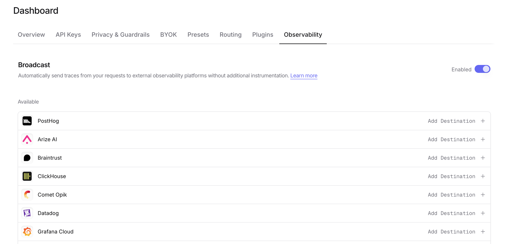

[OpenTelemetry](https://opentelemetry.io/) is an open-source observability framework for collecting, processing, and exporting telemetry data. OpenRouter can send traces to any backend that supports the OpenTelemetry Protocol (OTLP), including Axiom, Jaeger, Grafana Tempo, and self-hosted collectors.

## Step 1: Get your OTLP endpoint and credentials

Set up your OpenTelemetry-compatible backend and obtain the OTLP traces endpoint URL along with any required authentication headers.

For Axiom:
1. Create an Axiom account and dataset
2. Go to **Settings > API Tokens** and create a new token
3. Your endpoint is `https://api.axiom.co/v1/traces`
4. You'll need headers: `Authorization: Bearer xaat-xxx` and `X-Axiom-Dataset: your-dataset`

For self-hosted collectors:
1. Deploy an OpenTelemetry Collector with an OTLP receiver
2. Configure the receiver to listen on a publicly accessible endpoint
3. Note the endpoint URL (typically ending in `/v1/traces`)

## Step 2: Enable Broadcast in OpenRouter

Go to [Settings > Observability](https://openrouter.ai/settings/observability) and toggle **Enable Broadcast**.

<Frame>

</Frame>

## Step 3: Configure OpenTelemetry Collector

Click the edit icon next to **OpenTelemetry Collector** and enter:

- **Endpoint**: Your OTLP traces endpoint URL (e.g., `https://api.axiom.co/v1/traces` or `https://your-collector.example.com:4318/v1/traces`)
- **Send OTLP metrics** (optional, off by default): Also send [OTLP metrics](#metrics) for each generation, with the same headers. Leave it off to send traces only.
- **Metrics endpoint**: Your OTLP metrics endpoint URL (e.g., `https://your-collector.example.com:4318/v1/metrics`). Required while **Send OTLP metrics** is on: the form keeps **Test Connection** disabled until it is set, and the API (`shouldSendMetrics: true` without `metricsEndpoint`) rejects the configuration with "Metrics endpoint is required while Send OTLP metrics is on". Ignored while the checkbox is off, so turning it off stops metrics without clearing the URL.
- **Headers** (optional): Custom HTTP headers as a JSON object for authentication

Example headers for Axiom:
```json lines
{
  "Authorization": "Bearer xaat-your-token",
  "X-Axiom-Dataset": "your-dataset"
}
```

Example headers for authenticated collectors:
```json lines
{
  "Authorization": "Bearer your-token",
  "X-Custom-Header": "value"
}
```

## Step 4: Test and save

Click **Test Connection** to verify the setup. The configuration only saves if the test passes. With **Send OTLP metrics** on, the test also sends one `openrouter.connection_test` data point to the metrics endpoint and fails if that endpoint rejects it.

## Step 5: Send a test trace

Make an API request through OpenRouter and view the trace in your OpenTelemetry backend.

## Compatible backends

The OpenTelemetry Collector destination works with any backend that supports OTLP over HTTP, including:

- **Axiom** - Cloud-native log and trace management
- **Jaeger** - Distributed tracing platform
- **Grafana Tempo** - High-scale distributed tracing backend
- **Honeycomb** - Observability for distributed systems
- **Lightstep** - Cloud-native observability platform
- **Self-hosted OpenTelemetry Collector** - Route traces to multiple backends

<Tip>
OpenRouter sends traces using the OTLP/HTTP protocol with JSON encoding. Ensure your collector or backend is configured to accept OTLP over HTTP on the `/v1/traces` path, and on `/v1/metrics` if you send metrics.
</Tip>

## Metrics

With **Send OTLP metrics** on and a **Metrics endpoint** set, OpenRouter sends OTLP metrics alongside traces, as a separate OTLP/HTTP JSON request. The numbers are the ones already on the generation span, as time series you can aggregate without deriving them from spans.

### What is sent

Each generation produces one set of data points, measured from the generation itself; provider fallback attempts do not add to the counts.

| Metric | Type | Unit | Value | Sent when |
| --- | --- | --- | --- | --- |
| `gen_ai.client.token.usage` | Histogram | `{token}` | Prompt tokens (`gen_ai.token.type` = `input`) and completion tokens (`output`) | The count is known |
| `gen_ai.client.operation.duration` | Histogram | `s` | Generation end minus start | Always, except for a generation with no recorded end |
| `gen_ai.server.time_to_first_token` | Histogram | `s` | Time from the request reaching OpenRouter to the first token | The generation succeeded and its first token was measured, which needs a streamed provider response |
| `gen_ai.server.time_per_output_token` | Histogram | `s` | Mean time between output tokens after the first | The generation succeeded, the decode phase was measured, and there were at least two output tokens |
| `openrouter.router.duration` | Histogram | `s` | OpenRouter routing overhead | Router latency was measured |
| `openrouter.router.phase.duration` | Histogram | `s` | Time spent in each router timing phase, one data point per phase (`openrouter.router.phase`) | That phase was measured |
| `openrouter.router.attempts` | Histogram | `{attempt}` | Provider attempts made, including fallbacks; `0` when the request was never dispatched | The attempt count was recorded |
| `openrouter.provider.time_to_first_token` | Histogram | `s` | Time from dispatching the provider request to the first token, without OpenRouter's routing before dispatch | The generation succeeded and both the dispatch and the first token were measured |
| `openrouter.server.time_to_first_content_token` | Histogram | `s` | Time from the request reaching OpenRouter to the first answer token (text or tool call), ignoring reasoning | The generation succeeded and its first content token was measured, which needs a streamed provider response |
| `openrouter.token.usage` | Histogram | `{token}` | Token breakdowns, one data point per breakdown (`openrouter.token.type`) | Usage accounting has a value for that breakdown, `0` included |
| `openrouter.requests` | Sum (monotonic) | `{request}` | `1` | Always |
| `openrouter.cost` | Sum (monotonic) | `{USD}` | Total cost of the generation | The cost is known |
| `openrouter.upstream_inference_cost` | Sum (monotonic) | `{USD}` | The provider's prompt (`input`) and completion (`output`) inference cost, one data point each (`openrouter.cost.type`); not a split of `openrouter.cost` | Usage accounting has a value for that part, `0` included |

Histograms use the bucket boundaries of the [OpenTelemetry GenAI metric conventions](https://opentelemetry.io/docs/specs/semconv/gen-ai/gen-ai-metrics/): token buckets for `openrouter.token.usage`, and time-to-first-token buckets for the two `openrouter.*` first-token metrics. `openrouter.router.duration` uses buckets from 1 ms to 5 s, since routing overhead is usually a few milliseconds. `openrouter.router.phase.duration` extends those buckets to 100 s, because the provider and client-wait phases last as long as the generation. `openrouter.router.attempts` has one bucket per count up to 5, then 8 and 16. The `router` phase of `openrouter.router.phase.duration` differs from `openrouter.router.duration` because they come from different measurements: `openrouter.router.duration` is the time before the successful provider response less that attempt's own latency, so failed fallback attempts count toward it, and it includes guardrail, tool, routing-model, and media time. The `router` phase is the router's own time from the router timing breakdown: it reports failed attempts as `provider_failed` and those four as their own phases, but it includes router time after dispatch. Neither value is always the larger. `openrouter.cost` and `openrouter.upstream_inference_cost` are sent whether or not **Cost** is enabled under **Additional generation metadata**, because the same values are already on every span as `gen_ai.usage.total_cost`, `gen_ai.usage.input_cost`, and `gen_ai.usage.output_cost`.

<Warning>
Every `openrouter.token.usage` breakdown is already counted in the `input` or `output` total of `gen_ai.client.token.usage`: the cache, audio, and video breakdowns are part of `input`, and the reasoning and image breakdowns are part of `output`. Don't add `openrouter.token.usage` to `gen_ai.client.token.usage`, or sum `openrouter.token.usage` across `openrouter.token.type`; either counts the same tokens twice. Use the breakdowns as shares of the totals, such as a cache hit rate.

`openrouter.upstream_inference_cost` is the provider's prompt and completion inference cost, the API response's `cost_details.upstream_inference_prompt_cost` and `upstream_inference_completions_cost`. It does not add up to `openrouter.cost`. With your own provider key (BYOK), `openrouter.cost` is the BYOK fee, often `0`, while `openrouter.upstream_inference_cost` is usually OpenRouter's estimate of what the provider charges you. Web search, file parser, and web fetch charges, the data discount for allowing prompt logging, and the overage fee on non-BYOK usage appear only in `openrouter.cost`. On free endpoints and on requests refunded for producing no tokens or unusable audio, `openrouter.cost` is replaced by the plugin cost alone, and `openrouter.upstream_inference_cost` is not. An endpoint's discount to you lowers both metrics.
</Warning>

### Attributes

Every data point carries only these attributes, so the number of series stays bounded:

| Attribute | Value |
| --- | --- |
| `gen_ai.operation.name` | The API surface, e.g. `chat` or `embeddings`; left out for older requests that did not record it |
| `gen_ai.request.model` | The model, e.g. `openai/gpt-4o` |
| `gen_ai.provider.name` | The provider that served the generation |
| `openrouter.api_key.name` | The name of the API key that made the request. Each named key adds its own series, so the series count grows with the number of keys sending traffic |
| `error.type` | Failed generations only: the HTTP status code, or `_OTHER` |
| `http.response.status_code` | Failed generations only, when a status code was recorded |
| `openrouter.error.ownership` | Failed generations only, when known: `openrouter`, `provider`, `client`, `shared`, or `undeterminable` |
| `gen_ai.token.type` | `gen_ai.client.token.usage` only: `input` or `output` |
| `openrouter.token.type` | `openrouter.token.usage` only: `cache_read`, `cache_write`, `cache_write_5m`, `cache_write_1h`, `audio_input`, `video_input`, `reasoning`, or `image_output`, the same breakdowns as the span's `gen_ai.usage.input_tokens.*` and `gen_ai.usage.output_tokens.*` attributes |
| `openrouter.cost.type` | `openrouter.upstream_inference_cost` only: `input` or `output` |
| `openrouter.router.phase` | `openrouter.router.phase.duration` only: `router`, `provider`, `provider_failed`, `client_wait`, `guardrails`, `tools`, `routing_models`, or `media`, the span's `openrouter.router_timing.*_ms` attributes without `_ms` |

A `0` token breakdown or upstream cost part means OpenRouter's usage accounting recorded none, which for some providers or request types is a default rather than a provider-reported value. A breakdown or cost part is left out only when accounting has no value for it.

The resource carries `service.name` = `openrouter`. Trace, span and generation IDs, user and session IDs, prompts, and custom metadata are never metric attributes; use traces for those.

### Delta temporality

Data points use delta temporality: each one counts a single generation, over a window from the generation's start to its end. OpenRouter keeps no running totals between requests, so there are no cumulative series to reset. Data points from concurrent requests on the same series have overlapping windows.

Backends that store delta metrics natively ingest these as they arrive. Prometheus-compatible backends such as Prometheus, Mimir, and Thanos store cumulative series, so they need delta ingestion support or a conversion step in front of them. The OpenTelemetry Collector's `deltatocumulative` processor is one such step, but it applies the same checks to every metric type. It drops a data point whose timestamp is not newer than the last one it accepted for that series (`ErrOutOfOrder`), and one that starts before the series' first data point (`ErrOlderStart`). OpenRouter sends one data point per generation, in delivery order rather than time order, so on a busy series some points arrive out of order and are dropped, including two generations that end in the same millisecond. Every metric loses points on that path: `openrouter.requests`, `openrouter.cost`, and `openrouter.upstream_inference_cost` undercount your real requests and spend, and histograms lose samples. Check how your backend handles delta data before you build alerts or billing reports on these counts.

### Building metrics from spans instead

If you run Prometheus or Mimir and the `deltatocumulative` drops matter to you, you can build cumulative metrics from the traces OpenRouter sends instead. The Collector's [`spanmetrics` connector](https://github.com/open-telemetry/opentelemetry-collector-contrib/tree/main/connector/spanmetricsconnector) and Grafana Tempo's [metrics generator](https://grafana.com/docs/tempo/latest/metrics-generator/) both count calls and record durations from spans as they arrive and keep the running totals themselves, so the `deltatocumulative` ordering checks don't apply. The Collector connector accepts spans whenever they arrive. Tempo's metrics generator does not: it discards spans that ended more than `metrics_ingestion_time_range_slack` before they reach it (30 seconds by default), and counts them in `tempo_metrics_generator_spans_discarded_total` with `reason="outside_metrics_ingestion_slack"`. OpenRouter sends a trace after the generation ends, through a queue that retries failed deliveries, so a retried trace, or a provider-attempt span that ended well before its generation finished, can arrive outside that window. Raise the setting if that counter grows. You choose which span attributes become labels. They count spans and measure span durations; they don't add up attribute values such as token counts or cost. Every span becomes a sample, including the child spans for provider attempts, and the connector's default `span.name` label keeps those series apart.

A minimal connector that turns OpenRouter spans into request counts and durations by model and provider:

```yaml
connectors:
  spanmetrics:
    dimensions:
      - name: gen_ai.request.model
      - name: gen_ai.provider.name

service:
  pipelines:
    traces:
      receivers: [otlp]
      exporters: [spanmetrics]
    metrics:
      receivers: [spanmetrics]
      exporters: [prometheusremotewrite]
```

You still need an exporter for each pipeline, such as `prometheusremotewrite` configured for your Mimir endpoint, and you can keep exporting the traces too. OpenRouter has not tested this setup against its payloads.

### Delivery

- Metrics are sent only after the trace for that generation is accepted. A trace that is retried is sent with its metrics once, on the attempt that delivers it.
- A failed metrics request does not fail or retry the trace and is not retried itself, so counts can fall short while the metrics endpoint is unavailable.
- Metrics follow this destination's sampling rate and filter rules, because they are sent with the traces it sends. At a sampling rate of 0.5, the counts cover about half of your requests.
- Privacy Mode does not change metrics: they never contain prompt or completion content.

### Example collector configuration

A collector that receives traces and metrics from OpenRouter on port 4318 and forwards both to an OTLP backend:

```yaml
receivers:
  otlp:
    protocols:
      http:
        endpoint: 0.0.0.0:4318

processors:
  batch:

exporters:
  otlphttp:
    endpoint: https://otlp.example.com

service:
  pipelines:
    traces:
      receivers: [otlp]
      processors: [batch]
      exporters: [otlphttp]
    metrics:
      receivers: [otlp]
      processors: [batch]
      exporters: [otlphttp]
```

Set **Endpoint** to `https://your-collector.example.com:4318/v1/traces`, turn on **Send OTLP metrics**, and set **Metrics endpoint** to `https://your-collector.example.com:4318/v1/metrics`.

## Custom Metadata

Custom metadata from the `trace` field is sent as span attributes in the OTLP payload. How this metadata appears depends on your downstream backend.

### Supported Metadata Keys

| Key | OTLP Mapping | Description |
|-----|-------------|-------------|
| `trace_id` | Trace ID | Group multiple requests into a single trace |
| `trace_name` | Span Name | Custom name for the root span |
| `span_name` | Span Name | Name for intermediate spans in the hierarchy |
| `generation_name` | Span Name | Name for the LLM generation span |
| `parent_span_id` | Parent Span ID | Link to an existing span in your trace hierarchy |

### Example

```json lines
{
  "model": "openai/gpt-4o",
  "messages": [{ "role": "user", "content": "Hello!" }],
  "user": "user_12345",
  "session_id": "session_abc",
  "trace": {
    "trace_id": "app_trace_001",
    "trace_name": "Chat Handler",
    "generation_name": "Generate Response",
    "environment": "staging",
    "deployment": "us-east-1"
  }
}
```

### Span Attributes

Custom metadata keys are included as span attributes under the `trace.metadata.*` namespace. For example, `environment` from the trace field becomes `trace.metadata.environment` in the OTLP payload.

Standard GenAI semantic conventions (`gen_ai.*`) are used for model, token usage, and cost attributes.

Prompt and completion content is emitted once per generation, on the generation span, as `span.input` / `span.output` and `gen_ai.prompt` / `gen_ai.completion`. The root span no longer carries a duplicate copy under `trace.input` / `trace.output`; if your dashboards or processors read those keys, switch them to the generation-span attributes.

### Additional Context

- The `user` field maps to `user.id` in span attributes
- The `session_id` field maps to `session.id` in span attributes
- Your downstream backend determines how these attributes are indexed, queried, and displayed
- Using `parent_span_id` lets you link OpenRouter traces to your application's existing distributed traces

## Billing quantities

Cache-write details are exported as numeric attributes on the generation span:

| Attribute | Meaning |
| --- | --- |
| `gen_ai.usage.input_tokens.cache_write` | Total cache-write tokens. |
| `gen_ai.usage.input_tokens.cache_write_5m` | Five-minute cache-write tokens, when available. |
| `gen_ai.usage.input_tokens.cache_write_1h` | One-hour cache-write tokens, when available. |

With **Cost** enabled under **Additional generation metadata**, the same quantities and native-tool counters are also queryable under `span.metadata.openrouter_generation.*`. For example:

```json
{
  "span.metadata.openrouter_generation.cache_write_tokens": 300,
  "span.metadata.openrouter_generation.cache_creation.ephemeral_5m_input_tokens": 100,
  "span.metadata.openrouter_generation.cache_creation.ephemeral_1h_input_tokens": 200,
  "span.metadata.openrouter_generation.native_server_tool_use.web_search_requests": 1,
  "span.metadata.openrouter_generation.native_server_tool_use.code_execution_requests": 2,
  "span.metadata.openrouter_generation.usage_is_estimated": false
}
```

The example shows attribute values as a flat map; OTLP encodes numbers as `intValue` and the estimate flag as `boolValue`. Root spans also carry generation metadata under `trace.metadata.openrouter_generation.*`. Read each generation once. These representations repeat the same generation quantities; do not add them together. Unavailable quantities are omitted from OTEL attributes, while zero and `false` are preserved. See [Cost](/guides/features/broadcast#cost) for interpretation and billing caveats.

### Cost allocation

With **Cost allocation** enabled, the [cost-allocation block](/guides/features/broadcast#cost-allocation-beta) is flattened under its own key, independently of `openrouter_generation`. Counts are `intValue` attributes and costs are `stringValue` decimals, so no precision is lost:

```json
{
  "span.metadata.openrouter_cost_allocation.cost_status": "reconciled",
  "span.metadata.openrouter_cost_allocation.input_tokens": 1000,
  "span.metadata.openrouter_cost_allocation.cache_read_input_tokens": 400,
  "span.metadata.openrouter_cost_allocation.output_cost": "0.0005",
  "span.metadata.openrouter_cost_allocation.is_byok": false
}
```

Root spans also carry it under `trace.metadata.openrouter_cost_allocation.*`. Read each generation once.

### Raw provider usage

Unlike the quantities above, [`upstream_raw_response_usage`](/guides/features/broadcast#raw-provider-usage) is not flattened into one attribute per provider field. It is sent as a single `stringValue` attribute holding JSON, because its keys are provider-controlled and can change without notice:

```json
{
  "span.metadata.openrouter_generation.upstream_raw_response_usage": "{\"input_tokens\":4,\"output_tokens\":373,\"cache_creation_input_tokens\":300}"
}
```

Decode that string in your collector or query layer to read individual provider fields. The decoded value can be an object, an array of usage reports in provider order, or `null` — which is sent as the four-character string `null`, distinct from the attribute being absent. When it decodes to `null`, `upstream_raw_response_usage_suppression_reason` says whether the value was suppressed or simply unavailable.

This attribute keeps its path even when a generation carries more ordinary metadata than fits in the attribute budget. Because collectors and backends impose their own attribute value length limits, verify that your pipeline stores the complete JSON string before relying on it.

## Privacy Mode

When [Privacy Mode](/guides/features/broadcast#privacy-mode) is enabled for this destination, prompt and completion content and provider error text are excluded from traces. All other trace data — token usage, costs, timing, model information, and custom metadata — is still sent normally. Raw provider usage is replaced with `null` and reported as `privacy_mode`, because a provider's usage object can contain arbitrary future fields. See [Privacy Mode](/guides/features/broadcast#privacy-mode) for details.
