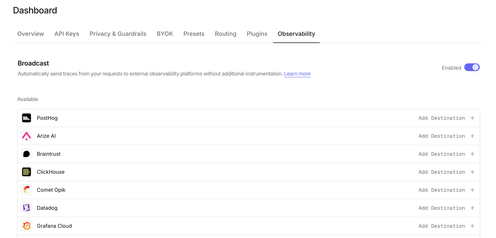

[Amazon S3](https://aws.amazon.com/s3/) is a scalable object storage service. OpenRouter can send traces to any S3-compatible storage, including AWS S3, Cloudflare R2, MinIO, and other compatible services.

## Choose a provider

The **Provider** field sets which object storage service hosts the bucket, and which connection fields the form shows:

| Provider | Endpoint | Authentication |
|----------|----------|----------------|
| AWS S3 | Set for you from the bucket's region; no endpoint field | Access keys or IAM role |
| Cloudflare R2 | Required, e.g. `https://your-account-id.r2.cloudflarestorage.com` | Access keys |
| Google Cloud Storage | Required: `https://storage.googleapis.com` | Access keys (HMAC keys) |
| Other S3-compatible | Required: your service's S3 API URL, e.g. a MinIO server | Access keys |

Today only AWS S3 supports IAM role authentication; every other provider uses access keys.

## Choose an authentication type (AWS S3)

- **IAM role** (recommended): OpenRouter assumes a role in your AWS account and gets short-lived credentials for each session, so there are no long-lived keys to create, store, or rotate. To cut off access, remove OpenRouter from the role's trust policy, which blocks new sessions, or delete the role. Credentials from a session that already started stay valid for up to an hour unless you also revoke the role's active sessions in IAM. Fields: **Role ARN** and **Region**. OpenRouter fills in the read-only **External ID** when you save.
- **Access keys**: an IAM user's access key ID and secret access key. Use this if you can't create IAM roles in the account. Fields: **Access Key Id**, **Secret Access Key**, optional **Session Token**, and optional **Region**. When Region is blank, OpenRouter looks the bucket's region up with `s3:GetBucketLocation` and falls back to `us-east-1` if the key can't call it, so set Region or grant that permission for buckets in other regions.

Both types also take **Bucket Name** and an optional **Path Template**.

## Set up with access keys

### Step 1: Create a bucket and credentials

In your cloud provider's console, create a bucket for storing traces (or use an existing one) and generate access credentials with write permissions to the bucket.

For AWS S3:

1. Go to **IAM > Users** and create a new user with programmatic access
2. Attach a policy that allows `s3:PutObject` on your bucket
3. Copy the Access Key ID and Secret Access Key

For Cloudflare R2:

1. Create a new R2 bucket in your Cloudflare dashboard
2. Go to **R2 > Manage R2 API Tokens** and create a new token with write permissions
3. Copy the Access Key ID, Secret Access Key, and your account's S3 endpoint

### Step 2: Enable Broadcast in OpenRouter

Go to [Settings > Observability](https://openrouter.ai/settings/observability) and toggle **Enable Broadcast**.

<Frame>

</Frame>

### Step 3: Configure S3

Click the edit icon next to **S3 / S3-Compatible** and enter:

- **Provider**: The service that hosts the bucket (see [Choose a provider](#choose-a-provider))
- **Authentication** (AWS S3 only): **Access keys**
- **Bucket Name**: Your S3 bucket name (e.g., `my-traces-bucket`)
- **Region** (optional): AWS region (auto-detected for AWS, required for some S3-compatible services)
- **Custom Endpoint** (all providers except AWS S3): The endpoint URL (e.g., `https://your-account-id.r2.cloudflarestorage.com`)
- **Access Key Id**: Your access key ID
- **Secret Access Key**: Your secret access key
- **Session Token** (optional): For temporary credentials
- **Path Template** (optional): Customize the object path. Default is `openrouter-traces/{date}`. Available variables: `{prefix}`, `{date}`, `{year}`, `{month}`, `{day}`, `{apiKeyName}`

### Step 4: Test and save

Click **Test Connection** to verify the setup. The configuration only saves if the test passes.

### Step 5: Send a test trace

Make an API request through OpenRouter and check your S3 bucket for the trace file. Each trace exported on its own is saved as a separate JSON file named `{traceId}-{timestamp}.json`; a batch export writes one `batch-{timestamp}.json` file holding a `traces` array.

## Set up with an IAM role

OpenRouter's exporter role assumes a role you create in your AWS account. You grant that access with the role's trust policy, and the role's permissions policy limits it to writing traces.

### Step 1: Create the destination and save it

Enable Broadcast at [Settings > Observability](https://openrouter.ai/settings/observability), click the edit icon next to **S3 / S3-Compatible**, and enter:

- **Provider**: **AWS S3**
- **Authentication**: **IAM role**
- **Role ARN**: The ARN of the role OpenRouter will assume, e.g. `arn:aws:iam::123456789012:role/openrouter-broadcast`. The role doesn't need to exist yet.
- **Bucket Name** and **Region**: The bucket and its AWS region. The region is required for IAM roles.
- **Path Template** (optional): As for access keys. Default is `openrouter-traces/{date}`.

Save the destination. Saving doesn't run a connection test, because the role can't be assumed until its trust policy requires the External ID, and OpenRouter only generates the **External ID** when you save. It is unique to this destination, appears only after the first save, and can't be edited. Copying a destination keeps the original's External ID, so the copy works with the same trust policy.

### Step 2: Copy the exporter role ARN and External ID

Reopen the destination and copy two values:

- OpenRouter's exporter role ARN: `arn:aws:iam::536697249728:role/openrouter-broadcast-exporter`
- The destination's **External ID**

The **Set up your AWS role** panel in the form shows the trust policy and permissions policy below with both values and your bucket already filled in, ready to copy.

### Step 3: Add the trust policy

In your AWS account, open the role in **IAM > Roles** (create it with a custom trust policy if it doesn't exist) and set its trust policy to allow `sts:AssumeRole` from OpenRouter's exporter role, only with this destination's External ID:

```json
{
  "Version": "2012-10-17",
  "Statement": [
    {
      "Sid": "AllowOpenRouterBroadcast",
      "Effect": "Allow",
      "Principal": {
        "AWS": "arn:aws:iam::536697249728:role/openrouter-broadcast-exporter"
      },
      "Action": "sts:AssumeRole",
      "Condition": {
        "StringEquals": {
          "sts:ExternalId": "YOUR_DESTINATION_EXTERNAL_ID"
        }
      }
    }
  ]
}
```

Replace `YOUR_DESTINATION_EXTERNAL_ID` with the value from Step 2. If two destinations share one role, list both External IDs: `"sts:ExternalId": ["id-1", "id-2"]`. When adding a destination to a role that already has a trust policy, add its ID to the existing list instead of pasting the generated policy over it, which would drop the other destination's ID.

### Step 4: Attach a permissions policy

Attach a policy that allows `s3:PutObject` on the bucket and the fixed prefix of your path template. If the bucket encrypts with SSE-KMS using a customer managed key, also allow `kms:GenerateDataKey` and `kms:Encrypt` on that key:

```json
{
  "Version": "2012-10-17",
  "Statement": [
    {
      "Sid": "WriteBroadcastTraces",
      "Effect": "Allow",
      "Action": "s3:PutObject",
      "Resource": "arn:aws:s3:::my-traces-bucket/openrouter-traces/*"
    },
    {
      "Sid": "EncryptBroadcastTraces",
      "Effect": "Allow",
      "Action": ["kms:GenerateDataKey", "kms:Encrypt"],
      "Resource": "arn:aws:kms:us-east-1:123456789012:key/1234abcd-12ab-34cd-56ef-1234567890ab"
    }
  ]
}
```

Omit the second statement for buckets that use SSE-S3 (the AWS default). Use the key ARN, not an alias ARN: IAM policies match keys by key ARN. Find it under the bucket's **Properties > Default encryption**. If your path template starts with a variable such as `{apiKeyName}`, there is no fixed prefix, so the resource covers the whole bucket (`arn:aws:s3:::my-traces-bucket/*`). The key policy must also let the role use the key; for a key in the role's own account, a key policy with the default `Enable IAM User Permissions` statement needs no change. A key in a different account must also grant the role `kms:GenerateDataKey` and `kms:Encrypt` in its key policy. Likewise, if the bucket belongs to a different AWS account than the role, the bucket policy must also grant the role `s3:PutObject`; the role's own policy is enough only for a bucket in the role's account.

If the role doesn't exist yet, instead of Steps 3 and 4 you can click **Download template** in the panel and deploy the CloudFormation template it downloads. It creates a new role from your Role ARN with both policies filled in; it can't adopt a role that already exists, so for an existing role attach the policies by hand. For an SSE-KMS bucket, enter the key ARN in the panel first so the template includes the KMS statement. Deploy it in the account named in the Role ARN, from the CloudFormation console (**Create stack > With new resources > Upload a template file**) or with the AWS CLI:

```bash
aws cloudformation deploy \
  --template-file openrouter-broadcast-role.json \
  --stack-name openrouter-broadcast-<role>-<hash> \
  --capabilities CAPABILITY_NAMED_IAM
```

Copy the exact command from the panel: its stack name is derived from the role name and the destination's External ID, so each destination gets its own stack. Deploying the template for a role that already exists, including one another destination's stack created, fails instead of replacing that role's trust policy; attach the policies to an existing role by hand. If your browser saved the download under another name, such as `openrouter-broadcast-role (1).json`, pass that file to `--template-file` or delete the older file first.

### Step 5: Test the connection

Back in the destination, click **Test Connection**. OpenRouter assumes your role and writes `.openrouter-connection-test.json` under the path template's prefix (for the default template, `openrouter-traces/<today's date>/.openrouter-connection-test.json`). Once it passes, send a request through OpenRouter and check the bucket for its trace file.

### Why the External ID exists

OpenRouter uses one exporter role to write to every customer's bucket. Without an External ID, anyone who learned your role's ARN could create their own destination with that ARN and have OpenRouter write into your bucket. This is the [confused deputy problem](https://docs.aws.amazon.com/IAM/latest/UserGuide/confused-deputy.html). OpenRouter generates the External ID itself, never accepts one you supply, and sends the destination's own ID on every AssumeRole call, so your trust policy only admits requests made for your destination.

Nothing changes on OpenRouter's side for each customer: the exporter role and its permissions stay the same, and all setup happens in your AWS account.

## Troubleshooting

When AWS denies access on an IAM role destination, **Test Connection** shows only `Destination rejected the request (status 403)`, whichever step AWS rejected. Other statuses have other causes: 429 means AWS throttled the request (retry shortly), and 502 means OpenRouter's side of the role chain failed rather than your setup. Check these causes in order:

1. **The trust policy is missing OpenRouter's principal.** `Principal.AWS` must be exactly `arn:aws:iam::536697249728:role/openrouter-broadcast-exporter`. Don't substitute the account root (`arn:aws:iam::536697249728:root`) or a `Principal.Service` entry: those trust a broader or different principal than the exporter role this guide sets up, and a typo matches nothing. Also check that the Role ARN on the destination names a role that exists.
2. **The External ID is missing or doesn't match.** The trust policy needs `StringEquals` on `sts:ExternalId` with the destination's External ID, character for character. Each destination has its own ID: deleting and re-creating a destination issues a new one, and a trust policy copied from another destination won't work. If the trust policy had no External ID condition at all, Test Connection reports that the role accepts any external ID, and OpenRouter keeps rejecting the role for up to five minutes after you add the condition, so wait before testing again.
3. **The permissions policy lacks `s3:PutObject`** on the bucket and prefix. The test writes under the same path as real traces, so a policy scoped to another bucket or prefix fails. One exception: the test and batch exports have no single API key, so `{apiKeyName}` becomes `unknown` in their paths. A policy scoped to `unknown/` passes the test but rejects traces exported one at a time from named keys, and a policy scoped to one key name rejects batch files, so scope the policy to the fixed prefix before the first variable, as the panel does. Also check that the bucket policy doesn't deny the role, for example by requiring a specific encryption header.
4. **KMS permissions are missing.** For an SSE-KMS bucket, the role needs `kms:GenerateDataKey` and `kms:Encrypt` on the bucket's key, and the key policy must let the role use it.
5. **The bucket region is wrong.** IAM role destinations don't auto-detect the region, so the **Region** field must be the bucket's region.

For access-key destinations, a 403 usually means the key's IAM user lacks `s3:PutObject` on the bucket, or the key was deactivated.

## Path template examples

Customize how traces are organized in your bucket:

- `openrouter-traces/{date}` - Default, organizes by date (e.g., `openrouter-traces/2024-01-15/abc123-1705312800.json`)
- `traces/{year}/{month}/{day}` - Hierarchical date structure
- `{apiKeyName}/{date}` - Organize by API key name, then date
- `production/llm-traces/{date}` - Custom prefix for environment separation

<Tip>
For time-based batching (e.g., hourly or daily aggregated files), consider using AWS Kinesis Firehose instead, which buffers records and writes batched files to S3.
</Tip>

## Custom Metadata

Custom metadata from the `trace` field is included in the JSON trace file stored in your S3 bucket. The metadata is available in the `metadata` field of each observation within the trace.

### Supported Metadata Keys

| Key | S3 JSON Mapping | Description |
|-----|-----------------|-------------|
| `trace_id` | `id` (trace level) | Custom trace identifier |
| `trace_name` | `name` (trace level) | Custom name for the trace |
| `span_name` | `name` (observation level) | Name for intermediate spans |
| `generation_name` | `name` (observation level) | Name for the LLM generation |

### Example

```json lines
{
  "model": "openai/gpt-4o",
  "messages": [{ "role": "user", "content": "Analyze this document..." }],
  "user": "user_12345",
  "session_id": "session_abc",
  "trace": {
    "trace_name": "Document Analysis",
    "generation_name": "Extract Key Points",
    "document_type": "contract",
    "batch_id": "batch_456"
  }
}
```

### Accessing Metadata in S3

Each trace file is a JSON object. Custom metadata keys from `trace` are stored in the `metadata` field and can be queried using tools like Amazon Athena, Presto, or any JSON-aware query engine:

```sql lines
-- Example Athena query on S3 trace files
SELECT
  json_extract_scalar(metadata, '$.document_type') as doc_type,
  json_extract_scalar(metadata, '$.batch_id') as batch_id
FROM openrouter_traces
WHERE json_extract_scalar(metadata, '$.document_type') = 'contract';
```

### Additional Context

- The `user` field maps to `userId` in the trace JSON
- The `session_id` field maps to `sessionId` in the trace JSON
- Trace files include full input/output messages, token counts, costs, and timing data alongside your custom metadata

## Billing quantities

For a single-trace file, cache-write details live under `trace.observations[].promptTokensDetails`. With the **Cost** metadata opt-in enabled, the generation quantities also appear under `trace.metadata.openrouter_generation` and the generation observation's `metadata.openrouter_generation`.

For example, the generation metadata may contain:

```json
{
  "is_byok": true,
  "cache_write_tokens": 300,
  "cache_creation": {
    "ephemeral_5m_input_tokens": 100,
    "ephemeral_1h_input_tokens": 200
  },
  "native_server_tool_use": {
    "web_search_requests": 1,
    "web_fetch_requests": 0,
    "code_execution_requests": 2
  },
  "usage_is_estimated": false
}
```

Batch files use `traces[]` instead of `trace`. Read each generation once. These representations repeat the same generation quantities; do not add them together. Null or omitted values are unavailable, while an explicit zero is a reported or observed zero. See [Cost](/guides/features/broadcast#cost) for estimation, TTL availability, and provider billing caveats.

### Raw provider usage

The same metadata locations carry [`upstream_raw_response_usage`](/guides/features/broadcast#raw-provider-usage) as ordinary JSON, so no additional decoding step is needed:

```json
{
  "upstream_raw_response_usage": {
    "input_tokens": 4,
    "output_tokens": 373,
    "cache_creation_input_tokens": 300,
    "cache_read_input_tokens": 0,
    "cache_creation": {
      "ephemeral_5m_input_tokens": 100,
      "ephemeral_1h_input_tokens": 200
    }
  }
}
```

The value can also be an array of usage reports or `null`, and its keys are the provider's own. Query it with a JSON-aware engine rather than a fixed column list, for example `json_extract(metadata, '$.openrouter_generation.upstream_raw_response_usage')` in Athena. When it is `null`, check `upstream_raw_response_usage_suppression_reason` to distinguish suppression from unavailable usage.

## Privacy Mode

When [Privacy Mode](/guides/features/broadcast#privacy-mode) is enabled for this destination, prompt and completion content and provider error text are excluded from traces. All other trace data (token usage, costs, timing, model information, and custom metadata) is still sent normally. Raw provider usage is replaced with `null` and reported as `privacy_mode`, because a provider's usage object can contain arbitrary future fields. See [Privacy Mode](/guides/features/broadcast#privacy-mode) for details.
