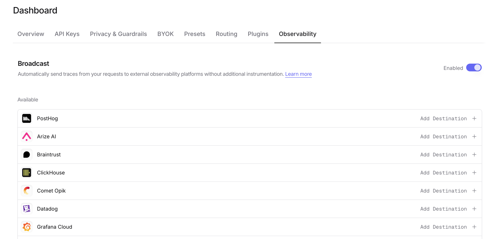

[Vantage](https://vantage.sh) is a cloud cost observability platform. With the Vantage destination, OpenRouter sends each generation's usage and cost, split by token kind, to Vantage's OpenTelemetry endpoint so you can allocate LLM spend by team, feature, or customer.

<Note>
The Vantage destination is in beta. Its configuration and the attributes it sends may change before it is generally available.
</Note>

## Step 1: Get your Vantage token

Get a token from Vantage that can send traces to its OpenTelemetry endpoint. OpenRouter sends traces to `https://ingest.vantage.sh/v1/traces` with the token as `Authorization: Bearer <token>`.

## Step 2: Enable Broadcast in OpenRouter

Go to [Settings > Observability](https://openrouter.ai/settings/observability) and toggle **Enable Broadcast**.

<Frame>

</Frame>

## Step 3: Configure Vantage

Click the edit icon next to **Vantage** and enter:

- **API key**: Your Vantage token

Under **Additional generation metadata**, a new Vantage destination starts with **Cost** and **Cost allocation** enabled. Keep **Cost allocation** enabled: it carries the per-token-kind usage and cost that Vantage allocates. Without it, Vantage receives only the generation's total token counts and cost.

## Step 4: Test and save

Click **Test Connection** to verify the setup. The configuration only saves if the test passes.

## Step 5: Send a test trace

Make an API request through OpenRouter and verify that its usage appears in Vantage.

## Trace Data

Vantage receives traces via the OpenTelemetry Protocol (OTLP). Each trace includes:

- **Token usage**: Prompt tokens, completion tokens, and total tokens consumed
- **Cost information**: The total cost of the request
- **Cost allocation**: Billed usage and cost by token kind, when **Cost allocation** is enabled
- **Timing**: Request start time, end time, and latency metrics
- **Model information**: The model slug and provider name used for the request
- **Request and response content**: The input messages and model output (unless [Privacy Mode](#privacy-mode) is enabled)

## Cost allocation

With **Cost allocation** enabled, the [cost-allocation block](/guides/features/broadcast#cost-allocation-beta) is sent as span attributes on the generation span under `span.metadata.openrouter_cost_allocation.*`. Counts are `intValue` attributes and costs are `stringValue` USD decimals, so no precision is lost:

```json
{
  "span.metadata.openrouter_cost_allocation.cost_status": "reconciled",
  "span.metadata.openrouter_cost_allocation.input_tokens": 1000,
  "span.metadata.openrouter_cost_allocation.non_cache_input_tokens": 600,
  "span.metadata.openrouter_cost_allocation.cache_read_input_tokens": 400,
  "span.metadata.openrouter_cost_allocation.output_tokens": 50,
  "span.metadata.openrouter_cost_allocation.non_cache_input_cost": "0.0012",
  "span.metadata.openrouter_cost_allocation.cache_read_input_cost": "0.0002",
  "span.metadata.openrouter_cost_allocation.output_cost": "0.0005",
  "span.metadata.openrouter_cost_allocation.platform_cost": "0.00019",
  "span.metadata.openrouter_cost_allocation.is_byok": false
}
```

The token kinds are `non_cache_input`, `cache_read_input`, `cache_write_input`, `output`, and `reasoning`, each with a `_tokens` count and a `_cost`. `input_tokens` is the total of the three input kinds. Tool, advisor, unclassified, and platform charges have their own `_cost` attributes, and `is_byok`, `billed_service_tier`, `is_long_context`, `endpoint_region`, and `endpoint_deployment_type` qualify the pricing. Counts and per-kind costs are present only when `cost_status` is `reconciled`; see [Cost allocation](/guides/features/broadcast#cost-allocation-beta) for every field and status.

Root spans also carry the block under `trace.metadata.openrouter_cost_allocation.*`. Read each generation once. The model and provider are in the standard `gen_ai.*` attributes.

## Custom Metadata

Custom metadata from the `trace` field is sent as span attributes in the OTLP payload.

### Supported Metadata Keys

| Key | OTLP Mapping | Description |
|-----|-------------|-------------|
| `trace_id` | Trace ID | Group multiple requests into a single trace |
| `trace_name` | Span Name | Custom name for the root span |
| `span_name` | Span Name | Name for intermediate spans in the hierarchy |
| `generation_name` | Span Name | Name for the LLM generation span |
| `parent_span_id` | Parent Span ID | Link to an existing span in your trace hierarchy |

### Example

```json lines
{
  "model": "openai/gpt-4o",
  "messages": [{ "role": "user", "content": "Summarize this support ticket..." }],
  "user": "user_12345",
  "session_id": "session_abc",
  "trace": {
    "trace_name": "Support Triage",
    "generation_name": "Summarize Ticket",
    "team": "support",
    "cost_center": "CC-1234"
  }
}
```

### Additional Context

- The `user` field maps to `user.id` in span attributes
- The `session_id` field maps to `session.id` in span attributes
- Custom metadata keys from `trace` are included as span attributes under the `trace.metadata.*` namespace, so you can allocate cost by them in Vantage
- Standard GenAI semantic conventions (`gen_ai.*`) are used for model, token usage, and cost attributes

## Privacy Mode

When [Privacy Mode](/guides/features/broadcast#privacy-mode) is enabled for this destination, prompt and completion content and provider error text are excluded from traces. All other trace data (token usage, costs, cost allocation, timing, model information, and custom metadata) is still sent normally. See [Privacy Mode](/guides/features/broadcast#privacy-mode) for details.
