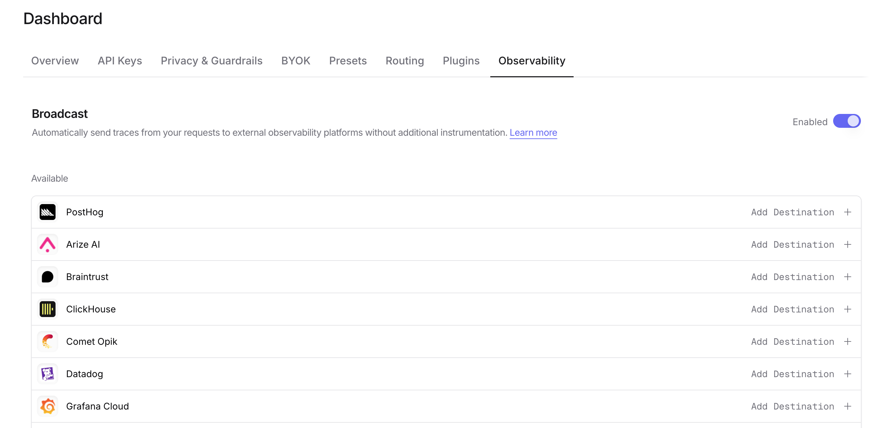

Webhook allows you to send traces to any HTTP endpoint that can receive JSON payloads. This is useful for integrating with custom observability systems, internal tools, or any service that accepts HTTP requests.

## Step 1: Set up your webhook endpoint

Create an HTTP endpoint that can receive POST or PUT requests with JSON payloads. Your endpoint should:

1. Accept `application/json` content type
2. Return a 2xx status code on success
3. Be publicly accessible from the internet

The endpoint will receive traces in [OpenTelemetry Protocol (OTLP)](https://opentelemetry.io/docs/specs/otlp/) format, making it compatible with any OTLP-aware system.

## Step 2: Enable Broadcast in OpenRouter

Go to [Settings > Observability](https://openrouter.ai/settings/observability) and toggle **Enable Broadcast**.

<Frame>

</Frame>

## Step 3: Configure Webhook

Click the edit icon next to **Webhook** and enter:

- **URL**: Your webhook endpoint URL (e.g., `https://api.example.com/traces`)
- **Method** (optional): HTTP method to use, either `POST` (default) or `PUT`
- **Headers** (optional): Custom HTTP headers as a JSON object for authentication or other purposes

Example headers for authenticated endpoints:
```json lines
{
  "Authorization": "Bearer your-token",
  "X-Webhook-Signature": "your-webhook-secret"
}
```

## Step 4: Test and save

Click **Test Connection** to verify the setup. The configuration only saves if the test passes. During the test, OpenRouter sends an empty OTLP payload with an `X-Test-Connection: true` header to your endpoint.

<Tip>
Your endpoint should return a 2xx status code for the test to pass. A 400 status code is also accepted, as some endpoints reject empty payloads.
</Tip>

## Step 5: Send a test trace

Make an API request through OpenRouter and verify that your webhook endpoint receives the trace data.

## mTLS client certificate

If your endpoint requires mutual TLS (mTLS), OpenRouter can present a client certificate when it sends traces to it.

<Note>
mTLS client certificates are available on request. Contact your OpenRouter account team to enable them for your organization. Until then, the Webhook editor does not show the mTLS section.
</Note>

Once mTLS is enabled, the Webhook editor shows an **mTLS client certificate** section. Paste each value in PEM format, or upload it from a `.pem` file:

- **Client certificate**: the certificate OpenRouter presents, optionally followed by its intermediate certificates.
- **Private key**: the certificate's private key, unencrypted, in PKCS#8 (`BEGIN PRIVATE KEY`), PKCS#1 RSA (`BEGIN RSA PRIVATE KEY`) or SEC1 EC (`BEGIN EC PRIVATE KEY`) format.
- **Server CA certificates** (optional): CA certificates to trust for your endpoint's server certificate, for example when it is signed by a private CA. They are added to the public root certificates, not used instead of them.

Encrypted private keys are not accepted. Decrypt the key first:

```bash
openssl pkey -in client-key.pem -out client-key-decrypted.pem
```

If you export the certificate and key from a PKCS#12 bundle with `openssl pkcs12 -nodes`, you can paste each block as exported: the `Bag Attributes` and `subject=` lines around it are ignored. Paste the certificate blocks into **Client certificate** and the key block into **Private key**.

After you save, the certificate and key are stored encrypted and never shown again. The editor shows when the certificate expires, warns once it is within 30 days of expiry, and offers **Replace** and **Remove**. Remove deletes the certificate, private key and server CA certificates together.

### How mTLS changes delivery

- The endpoint URL must use `https://`.
- Redirects to a different origin are not followed while a client certificate is set.
- Traces to this destination are sent from OpenRouter's queue workers in each data region (Global, US and EU) instead of inline, with a single delivery attempt.
- Queued messages are limited to 5 MB, so a very large trace payload can be truncated or dropped.
- **Test Connection** and **Send Trace** cannot present the certificate from the dashboard. Instead of contacting your endpoint, they check that the certificate and key are valid PEM, belong together and have not expired. The TLS handshake with your endpoint is first tested by a real delivery, so make a request through OpenRouter and confirm that your endpoint receives the trace.
- Replace the certificate before it expires: deliveries fail once it has expired.
- If mTLS access is removed from your organization, the saved certificate stays in place but the destination cannot be turned on or kept on. Remove the certificate or turn the destination off before saving other changes to it.

## Payload format

Traces are sent in OTLP JSON format. Each request contains a `resourceSpans` array with span data including:

- Trace and span IDs
- Timestamps and duration
- Model and provider information
- Token usage and cost
- Request and response content (with multimodal content stripped)

Example payload structure:
```json expandable lines
{
  "resourceSpans": [
    {
      "resource": {
        "attributes": [
          { "key": "service.name", "value": { "stringValue": "openrouter" } }
        ]
      },
      "scopeSpans": [
        {
          "spans": [
            {
              "traceId": "abc123...",
              "spanId": "def456...",
              "name": "chat",
              "startTimeUnixNano": "1705312800000000000",
              "endTimeUnixNano": "1705312801000000000",
              "attributes": [
                { "key": "gen_ai.request.model", "value": { "stringValue": "openai/gpt-4" } },
                { "key": "gen_ai.usage.prompt_tokens", "value": { "intValue": "100" } },
                { "key": "gen_ai.usage.completion_tokens", "value": { "intValue": "50" } }
              ]
            }
          ]
        }
      ]
    }
  ]
}
```

## Use cases

The Webhook destination is ideal for:

- **Custom analytics pipelines**: Send traces to your own data warehouse or analytics system
- **Internal monitoring tools**: Integrate with proprietary observability platforms
- **Event-driven architectures**: Trigger workflows based on LLM usage
- **Compliance logging**: Store traces in systems that meet specific regulatory requirements
- **Development and testing**: Use services like [webhook.site](https://webhook.site) to inspect trace payloads

<Tip>
For production use, ensure your webhook endpoint is highly available and can handle the expected volume of traces. Consider implementing retry logic on your end for any failed deliveries.
</Tip>

## Custom Metadata

Custom metadata from the `trace` field is included as span attributes in the OTLP JSON payload sent to your webhook endpoint.

### Supported Metadata Keys

| Key | OTLP Mapping | Description |
|-----|-------------|-------------|
| `trace_id` | `traceId` | Group multiple requests into a single trace |
| `trace_name` | Span `name` | Custom name for the root span |
| `span_name` | Span `name` | Name for intermediate spans in the hierarchy |
| `generation_name` | Span `name` | Name for the LLM generation span |
| `parent_span_id` | `parentSpanId` | Link to an existing span in your trace hierarchy |

### Example

```json lines
{
  "model": "openai/gpt-4o",
  "messages": [{ "role": "user", "content": "Process this order..." }],
  "user": "user_12345",
  "session_id": "session_abc",
  "trace": {
    "trace_id": "order_processing_001",
    "trace_name": "Order Processing Pipeline",
    "generation_name": "Extract Order Details",
    "order_id": "ORD-12345",
    "priority": "high"
  }
}
```

### Accessing Metadata in Your Webhook

Custom metadata keys appear as span attributes in the OTLP payload under the `trace.metadata.*` namespace:

```json lines
{
  "resourceSpans": [{
    "scopeSpans": [{
      "spans": [{
        "attributes": [
          { "key": "trace.metadata.order_id", "value": { "stringValue": "ORD-12345" } },
          { "key": "trace.metadata.priority", "value": { "stringValue": "high" } }
        ]
      }]
    }]
  }]
}
```

### Additional Context

- The `user` field maps to `user.id` in span attributes
- The `session_id` field maps to `session.id` in span attributes
- All standard GenAI semantic conventions (`gen_ai.*`) are included for model, token, and cost data

## Privacy Mode

When [Privacy Mode](/guides/features/broadcast#privacy-mode) is enabled for this destination, prompt and completion content and provider error text are excluded from traces. All other trace data — token usage, costs, timing, model information, and custom metadata — is still sent normally. See [Privacy Mode](/guides/features/broadcast#privacy-mode) for details.
