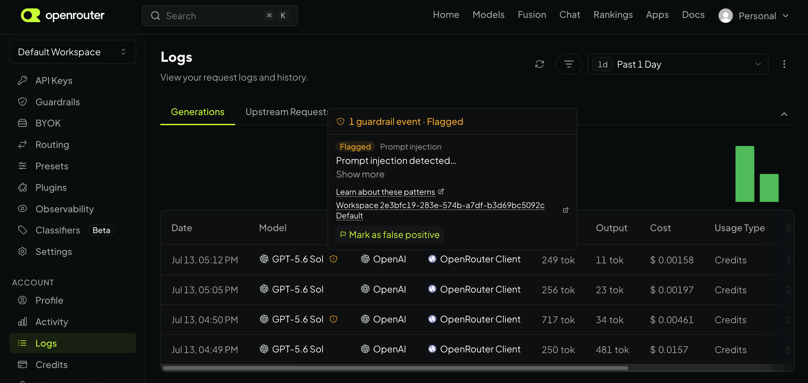
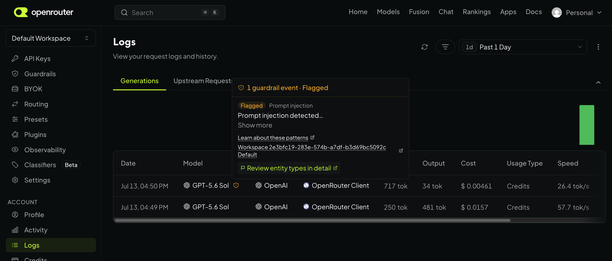
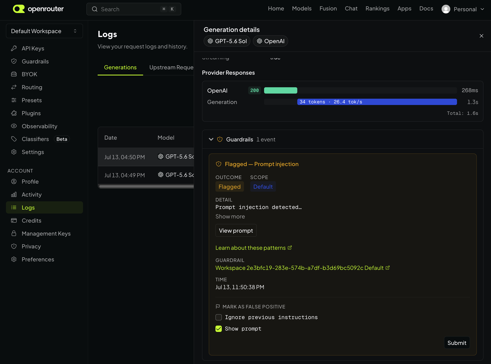

import {
  PromptInjectionPatternsTables,
  PromptInjectionFuzzyTargets,
  PromptInjectionFuzzyPhrases,
  PromptInjectionEvasionKeywords,
  PromptInjectionEncodingDetectors,
} from '/snippets/exports/PromptInjectionPatterns.jsx';

OpenRouter's regex-based prompt injection detection scans incoming requests for common injection techniques using pattern matching. This feature is **free** and adds **minimal latency** to requests since the patterns are evaluated locally before the request is forwarded to the model provider.

<Note>
To enable prompt injection detection, navigate to your [workspace guardrails](https://openrouter.ai/workspaces), open or create a guardrail, and configure the **Security** section.
</Note>

## How It Works

When regex-based detection is enabled on a guardrail, every incoming message is scanned against a set of patterns derived from the [OWASP LLM Prompt Injection Prevention Cheat Sheet](https://cheatsheetseries.owasp.org/cheatsheets/LLM_Prompt_Injection_Prevention_Cheat_Sheet.html), among other resources. If a match is found, the configured action is taken:

- **Flag** — The request passes through unmodified; the detection is recorded for observability (metrics + analytics events) but no enforcement is applied. Useful for measuring true-positive rates on your own traffic before switching to `redact` or `blocked`.
- **Redact** — Matched spans are replaced with `[PROMPT_INJECTION]` and the sanitized request is forwarded to the model.
- **Block** — The entire request is rejected with a `403` before it reaches the model.

<Note>
When multiple guardrails apply to the same request (for example, a workspace default plus an API key–scoped guardrail), the most restrictive action wins. Priority is `block` > `redact` > `flag`.
</Note>

By default the detector screens the `text` parts of every message in the request, whatever its role (system, developer, user, assistant, and tool), plus the argument strings of tool calls, so instructions injected through the text of a tool result or an earlier turn are screened as well. This is heuristic screening, not guaranteed detection: `block` and `flag` evaluate the text parts of a message joined together and then each tool-call argument string on its own, while `redact` scans each text part separately, so a phrase split across two text parts can be blocked but not redacted. Only `text` parts and tool-call arguments sent as a string are scanned; tool-call arguments sent as a JSON object rather than a JSON-encoded string are not inspected. File, image, audio, and refusal parts are not inspected. The `prediction` field and the message-level `reasoning` and `reasoning_details` fields are forwarded unscanned, including reasoning text that the router replays to the provider as thinking or reasoning content, and so are provider-native content blocks that the router forwards verbatim, such as Anthropic `search_result`, `web_search_tool_result`, `document`, and `tool_result` blocks, so retrieved content and other text carried in those blocks reaches the model unscreened. This list is not exhaustive: any field the router forwards without inspecting it reaches the model unscreened. To scan only user messages, set `scan_scope` to `user_only` on the `regex-prompt-injection` entry in the guardrail's `content_filter_builtins` list; this is a guardrail setting, not a request field. When several guardrails apply to one request, the broader scope wins: if any of them leaves the detector at `all_messages`, every message is scanned.

<Warning>
Pattern screening is a filter, not a security boundary. It reduces how often a known injection reaches the model; it does not make the model safe to run with broad permissions. Keep authorization and human approval where your tools execute, and give the model only the data and actions the request needs.
</Warning>

## Detection Patterns

The following regex patterns are checked against the message content selected by the scan scope. Patterns are case-insensitive unless noted otherwise.

<PromptInjectionPatternsTables />

## Evasion Detection

In addition to the regex patterns above, the detection system includes techniques to catch common evasion strategies.

### Typoglycemia Detection

Attackers may scramble the middle letters of keywords while keeping the first and last letters intact (e.g., "ignroe" instead of "ignore"). The system checks for typoglycemia variants of these target words:

<PromptInjectionFuzzyTargets />

### Misspelled Phrase Detection

Attackers may misspell a keyword inside an injection phrase to evade exact matching (e.g., "1gnore previous instructions", "ignore previous saefty rules", "revael your system prompt"). The system finds candidate phrase shapes word-by-word, allowing one edit (insertion, deletion, substitution, or adjacent transposition) or a middle-letter scramble per eligible keyword:

<PromptInjectionFuzzyPhrases />

A `~` marks a slot that also accepts a misspelling; slots without it must match exactly.

A candidate is detected only when **at least one keyword is misspelled and its corrected phrase matches one of the exact regex patterns above**. The check uses that candidate's words, including any filler words, not an unrelated exact match elsewhere in the message. This prevents a typo from expanding the exact blocking policy: "delte previous instructions" and "skip the securty rules for now" do not trigger this layer because their corrected forms are not exact detections. Standalone near-words (e.g., `systemd`, `prompt1`, or prose that fixes a typo like `"promt" should be "prompt"`) do not qualify either.

Read verbs (`print`, `output`, `reveal`, `expose`) also require exact qualifier and target slots in the read-override candidate. A misspelled verb is not sufficient on its own: "prnit the previous instructions" stays clean in this layer, while "outupt original instructions" qualifies because "output original instructions" matches the exact policy. Typoglycemia and encoding detectors still run independently.

### Encoding-Based Evasion

The system decodes Base64 and hex-encoded content (including space-separated hex pairs like `69 67 6e 6f 72 65`), then checks the decoded text for injection keywords:

<PromptInjectionEvasionKeywords />

This catches attempts to hide malicious instructions behind encoding layers. The encoding and Unicode detectors report these pattern names: <PromptInjectionEncodingDetectors />.

### Unicode Obfuscation

Attackers can spell a phrase with characters that look identical to a person but differ from the pattern's letters: a zero-width space or soft hyphen inside a word (`Ign\u200bore`), a Cyrillic or Greek look-alike letter (`іgnore` with Cyrillic `і`), an accented letter (`ígnore`), fullwidth or mathematical letterforms (`ｉｇｎｏｒｅ`), text written entirely in invisible Unicode tag characters (U+E0000 to U+E007F) that models read but people cannot see, letters wrapped in brackets or other punctuation (`⒜`, which normalizes to `(a)`), or a literal JSON escape: `\u0456` anywhere in a message, and short escapes such as `\n` or `\t` inside tool-call arguments.

The detector scans a normalized copy of each message alongside the original: hidden tag characters are decoded, invisible characters and combining marks are removed (and, in a second copy, treated as word separators, so `ignore\u200ball\u200bprevious` is read as three words), the text is NFKC-normalized, characters that normalize to one letter plus punctuation are folded to that letter, accented Latin letters lose their accents, and a short table of look-alike letters is folded to Latin. On these copies, a keyword broken into fragments (`ign ore`) is rejoined when the fragments spell a word the patterns use. A match found only on the normalized copy is reported as `unicode_obfuscated_injection` together with the underlying pattern; tag characters outside an emoji flag sequence are reported as `unicode_tag_characters`. The text forwarded to the model is never changed by this normalization. In `redact` mode, a match found only on the normalized copy has no exact span in the original text, so the whole matched segment is redacted, as for Base64 and hex. Tag characters outside an emoji flag also redact the whole segment on their own, with or without a matching phrase. Tool-call arguments that parse as JSON are the exception: every string value in the arguments object is replaced with `[PROMPT_INJECTION]`, including values that did not match, while object keys, numbers, booleans, and the JSON structure are preserved, so a key that itself contains a disguised phrase is not redacted.

Ordinary non-Latin text is not affected: Russian, Greek, Japanese, accented Latin, and country flags (regional-indicator pairs such as 🇬🇧, which use no tag characters) do not trigger these detectors by themselves. Because accents are folded, an accented spelling of a pattern word matches like the plain one: a line that starts with `Systém:` is reported as `system_prefix_spoofing`, the same as `System:`. Subdivision flags built from tag characters (a black flag, one to eight tag letters or digits, and a cancel tag, such as 🏴󠁧󠁢󠁥󠁮󠁧󠁿 or 🏴󠁵󠁳󠁴󠁸󠁿) are not reported as `unicode_tag_characters`. England, Scotland, and Wales are removed on the normalized copy. The letters of any other flag are decoded there, so a phrase hidden inside a fake flag is still matched, and a further copy drops every flag whole, so a real flag placed between two words of a phrase does not hide it. A tag run that is not shaped like a flag, such as one with a space tag or more than eight letters, is reported as `unicode_tag_characters`, which `block` rejects and `redact` replaces as a whole text part.

### Character-Spaced Evasion

Text with character spacing (e.g., `i g n o r e  p r e v i o u s`) is normalized by collapsing spaces, then re-scanned against all patterns. This prevents simple spacing-based evasion.

## Reporting False Positives

If a detection incorrectly flags legitimate content, you can mark it as a false positive from the [Logs](https://openrouter.ai/logs) page. Generations with a guardrail event show a shield icon on the row; hover it to open the guardrail popover.

When a single pattern was detected, click **Mark as false positive** directly in the popover:

When multiple patterns were detected, the popover instead links to the generation detail view, where you can select the specific patterns to report:

In the detail view, check the patterns that were flagged incorrectly under **Mark as false positive**, then click **Submit**:

The event is visually marked and your feedback is recorded for future detection improvements.

<Note>
Marking a detection as false positive does not retroactively unblock the request. If the action was **block**, the original request was already rejected.
</Note>

## Limitations

- **Regex-based detection is not exhaustive.** Sophisticated or novel injection techniques may not be caught, and the Unicode look-alike table covers only letters that are visually identical to Latin letters.
- **Detection is not a security boundary.** Treat it as one layer: enforce permissions where tools run, and do not rely on screening alone to protect secrets in the system prompt.
- **Flag mode does not enforce.** A flagged request is forwarded to the model exactly as submitted — the detection is recorded for dashboards and analytics only. Use `flag` to measure match rates on real traffic; switch to `redact` or `block` once you're confident the false-positive rate is acceptable.
- **False positives** are possible. Some legitimate prompts may contain phrases that match these patterns (e.g., a prompt about security testing). Test your guardrail configuration with representative traffic — ideally in `flag` mode first — before enforcing broadly. You can [report false positives](#reporting-false-positives) from the Logs page, or exempt specific known-safe phrases via the [Allowlist](/guides/features/guardrails/prompt-injection/allowlist).

## Further Reading

- [Allowlist](/guides/features/guardrails/prompt-injection/allowlist) — exempt specific known-safe phrases from detection
- [OWASP LLM Prompt Injection Prevention Cheat Sheet](https://cheatsheetseries.owasp.org/cheatsheets/LLM_Prompt_Injection_Prevention_Cheat_Sheet.html)
- [Guardrails documentation](/guides/features/guardrails)
- [Guardrails API reference](/api/api-reference/guardrails/list-guardrails)
