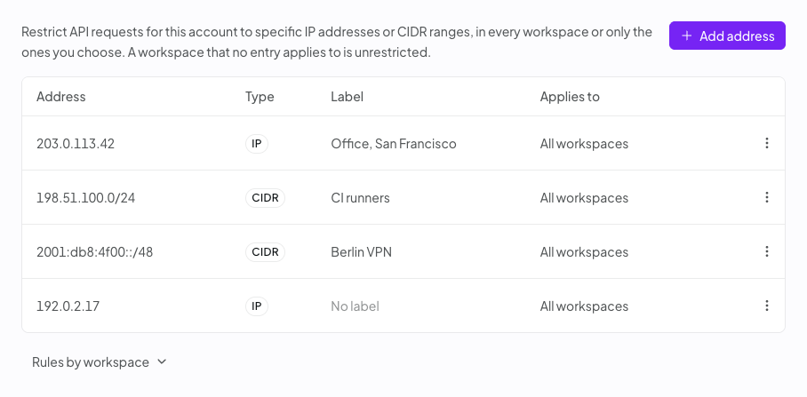

The [Security settings page](https://openrouter.ai/settings/security) helps you find risky API keys and protect your account. It has three tabs: Overview, Key safety, and IP allowlist.

<Note>
  Personal accounts and organization administrators can edit the maximum key lifetime setting. On the Enterprise plan, they can also edit the IP allowlist. Organization administrators can see every key in the organization and copy a list of key owners. Organization members see only the keys they created.
</Note>

## Overview

The Overview tab shows four cards. Select a card to open the Key safety tab filtered to those keys.

- **No spend limit**: keys without a credit limit. A leaked key could spend without a cap.
- **Never expires**: keys that stay valid until someone removes them.
- **Never used or idle 90+ days**: keys with no requests in the last 90 days.
- **Safe to remove**: idle keys with little or no lifetime usage.

If you're an organization member and any of your keys have no spend limit or never expire, a warning asks you to set a limit and an expiration on each one.

### Recommendations

Below the cards, the Overview tab lists recommendations for the keys that need attention:

- **Remove unused keys**: confirm with each owner, then archive the keys.
- **Set a spend limit**: cap what a leaked key can spend.
- **Review keys without expiration**: replace them with expiring keys, or remove the ones you no longer need.
- **Enforce a maximum key lifetime**: set a maximum API key lifetime in [privacy settings](https://openrouter.ai/settings/privacy). OpenRouter rejects requests from keys that never expire or that exceed the maximum lifetime, including existing keys. The policy also covers keys issued through OAuth consent, such as OpenRouter MCP keys, which are capped at 7 days on their own and get the shorter lifetime when the policy is stricter. Choose **No expiration** to allow any lifetime.

If you are an admin, you can select **Copy owner list** to copy a CSV of key owners and key names. Give the CSV to your agent or your team to coordinate cleanup with each owner.

## Key safety

The Key safety tab lists your active API keys. Disabled, expired, and archived keys aren't shown, and management keys are hidden unless you select **Show management keys**.

To narrow the list, use the following controls:

- Search by key name or label. Administrators can also search by owner.
- Filter by risk: **No limit** or **No expiry**.
- Filter by inactivity, from **Unused 30+ days** to **Unused 180+ days**, or show keys that were never used.
- Filter by owner, or show keys with no recorded owner.
- Show only keys that are **Safe to remove**.

### Risk and Status columns

The **Risk** column summarizes which safeguards a key lacks, such as **No limit**, **No expiry**, or **No limit or expiry**. Keys with a limit of $1,000 or more, or an expiration more than 365 days out, are also flagged. Hover over the label to see every risk factor for the key. By default, keys with compounding risk factors sort higher.

The **Status** column rates how safe a key is to remove based on its usage: **Safe to remove**, **Review before removing**, or **In use**. Hover over the label for details.

### Act on keys

Each key row lets you disable or archive the key, and keys without a spend limit also offer **Set limit**. To act on several keys at once, select them and choose **Set limit**, **Disable**, or **Archive** from the selection bar.

You can't change the expiration of an existing key. To replace a key, create a new key with an expiration, move your apps to it, and then disable or archive the old key. To enforce expiration on every key, including existing ones, set a maximum key lifetime in [privacy settings](https://openrouter.ai/settings/privacy). OpenRouter then rejects requests from any key that never expires or that expires later than the maximum lifetime allows.

Disabling a key is reversible. Archiving a key is permanent and asks you to type `archive` to confirm. Before you do either, make sure nothing still depends on the key.

## IP allowlist

<Note>
  The IP allowlist requires an Enterprise plan. Other accounts see an upgrade prompt on this tab.
</Note>

The IP allowlist restricts which IP addresses can use your account's API keys for inference requests and for other API requests, both reads and writes, such as credits, activity, generations, generation feedback, analytics, file uploads, and batch submissions. When the list is empty, requests from any IP address are accepted. After you add an entry, OpenRouter checks the client IP of each of these requests against the entries that apply to it and rejects requests from other addresses with a `403 Forbidden` error. The allowlist applies to every API key in the personal account or organization, including existing keys. Before you add the first entry, include the address of every server, office network, and CI runner that calls the API, or those requests start failing. To turn the restriction off, remove every entry.

Management API keys are checked on the same endpoints when those endpoints accept them. There, a management key not scoped to a workspace must match an entry that applies to all workspaces, and a management key scoped to a workspace must match an entry that applies to that workspace. If no entry applies to all workspaces, management keys not scoped to a workspace are unrestricted.

The allowlist is not checked, for any key, on these endpoints:

- Skills (`/api/v1/skills`).
- [Vault](/guides/ori/vault) (`/api/v1/vault`) and interns (`/api/v1/interns`).
- [Stripe Projects](/guides/overview/stripe-projects) provisioning (`/api/v1/provisioning`).
- Endpoints that accept only management keys, such as those that create and manage API keys, workspaces, and guardrails.

To add an entry, open the IP allowlist tab and select **Add address**, or **Add IP address** if the list is empty. Enter a single IPv4 or IPv6 address, such as `203.0.113.42`, or a CIDR range, such as `10.0.0.0/8`, and optionally a label that describes it. Under **Applies to**, choose **All workspaces** or **Specific workspaces**, and for specific workspaces check up to 100 of them. Then select **Add address** to save. Changes apply immediately. To edit or remove an entry, open the actions menu at the end of its row and select **Edit** or **Remove**. Only personal accounts and organization administrators can edit the list; organization members see a notice that administrator access is required.

### Workspace scope

Each entry applies either to all workspaces or to the workspaces you choose. Entries added before workspace scope existed apply to all workspaces. A request in a workspace is accepted only from an address in an entry that applies to that workspace. A workspace that no entry applies to is unrestricted, and requests in it are accepted from any IP address. The **Applies to** column shows each entry's scope.

Select **Rules by workspace** to see, for each workspace, the entries that apply to it and whether it is unrestricted. The view also lists management keys not scoped to a workspace, which only entries that apply to all workspaces cover, and any deleted workspace an entry still names.

While you add or edit an entry, the dialog names the workspaces, and the management keys not scoped to a workspace, that no entry would apply to once you save. When removing an entry would leave workspaces or those management keys with no applicable entry, OpenRouter asks you to confirm and names what would become unrestricted.

## Related guides

- To manage keys programmatically, see [Management API Keys](/guides/overview/auth/management-api-keys).
- To run these checks with the API, see the [API key audit cookbook](/cookbook/administration/api-key-audit).
- For key rotation best practices, see the [API key rotation cookbook](/cookbook/administration/api-key-rotation).
