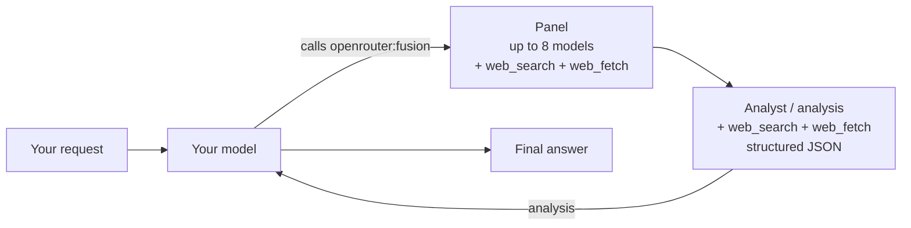

The [Fusion Router](https://openrouter.ai/openrouter/fusion) (`openrouter/fusion`) is designed for deep research. It gives your model access to a multi-model deliberation tool. When invoked, a panel of models answers your prompt in parallel, then an analyst model compares their responses and returns structured analysis covering consensus, contradictions, coverage gaps, unique insights, and blind spots. Your model uses that analysis to write a better final answer.

## Overview

Use Fusion when a single model isn't enough: research questions, expert critique, "compare and contrast" prompts, or anything where the cost of being wrong outweighs the cost of a few extra completions.

## How it works



1. You send a request with `model: "openrouter/fusion"`. The router resolves the alias to a real model and attaches the `openrouter:fusion` tool.
2. Your model reads the prompt and decides whether the task warrants deliberation. If so, it invokes `openrouter:fusion`. (Use `tool_choice: "required"` to guarantee invocation.)
3. The **panel** (a set of models) answers your prompt in parallel, each with `openrouter:web_search` and `openrouter:web_fetch` enabled.
4. The **analyst** receives all panel responses, with `openrouter:web_search` and `openrouter:web_fetch` available, and compares them (it doesn't merge them). It returns structured analysis as JSON: what all or most models agreed on (treated as higher-confidence consensus), where they disagreed, what only some models covered, unique insights from individual models, and blind spots none of them addressed.
5. Your model receives the analysis and writes the final answer.

`openrouter:web_search` and `openrouter:web_fetch` are enabled on both the panel and the analyst calls, so models can pull fresh sources while they answer and analyze.

## Two ways to use it

<CodeGroup>

```json title="Model alias (tool auto-injected)" lines
{
  "model": "openrouter/fusion",
  "input": "What are the strongest arguments for and against carbon taxes?"
}
```

```json title="Server tool (explicit)" lines
{
  "model": "~anthropic/claude-opus-latest",
  "input": "What are the strongest arguments for and against carbon taxes?",
  "tools": [
    { "type": "openrouter:fusion" }
  ]
}
```

</CodeGroup>

Both hit the same pipeline. The model alias is simpler because it auto-injects the tool so you don't have to declare it. The server tool form gives you more control (choose your own outer model, combine fusion with other tools).

In both cases, the model decides when to call `openrouter:fusion`. For prompts that don't need deliberation, it answers directly, including invoking any other tools you've defined. Add `tool_choice: "required"` to force fusion on every request.

## Fast preset model: `openrouter/fusion-flash`

`openrouter/fusion-flash` is a separately-listed model that runs the fusion pipeline with the `general-fast` preset pre-selected, a latency-homogeneous panel tuned for fast agentic turns. When you don't pin your own fusion config, these two requests behave the same:

<CodeGroup>

```json title="Fusion Flash"
{
  "model": "openrouter/fusion-flash",
  "input": "..."
}
```

```json title="Explicit preset"
{
  "model": "openrouter/fusion",
  "plugins": [{ "id": "fusion", "preset": "general-fast" }],
  "input": "..."
}
```

</CodeGroup>

The model pins the preset as a default and gets its own entry in `/api/v1/models` and its own usage attribution in your activity feed. Anything you pass explicitly wins: a `fusion` plugin config with its own `preset`, `analysis_models`, or `model` overrides the implied `general-fast`. Variant suffixes (`openrouter/fusion-flash:free`) parse the same way they do on `openrouter/fusion`.

## Quick start

<CodeGroup>

```typescript title="TypeScript SDK" lines
import { OpenRouter } from '@openrouter/sdk';

const openRouter = new OpenRouter({
  apiKey: '<OPENROUTER_API_KEY>',
});

const response = await openRouter.responses.send({
  responsesRequest: {
    model: 'openrouter/fusion',
    input: 'Survey the strongest arguments for and against a carbon tax. Where do experts disagree?',
  },
});

if (!('output' in response)) {
  throw new Error('Expected a non-streaming response');
}
if (response.status !== 'completed') {
  throw new Error(response.error?.message ?? `Response ended as ${response.status}`);
}

const message = [...response.output].reverse().find((item) => item.type === 'message');
console.log(message?.content.find((part) => part.type === 'output_text')?.text);
```

```bash title="cURL" lines
curl -sS https://openrouter.ai/api/v1/responses \
  -H "Authorization: Bearer $OPENROUTER_API_KEY" \
  -H "Content-Type: application/json" \
  -d '{
    "model": "openrouter/fusion",
    "input": "Survey the strongest arguments for and against a carbon tax. Where do experts disagree?"
  }' | jq -r '.model, (.output[] | select(.type == "message") | .content[] | select(.type == "output_text") | .text)'
```

```go title="Go" lines
package main

import (
	"bytes"
	"encoding/json"
	"fmt"
	"log"
	"net/http"
	"os"
)

func main() {
	body, _ := json.Marshal(map[string]any{
		"model": "openrouter/fusion",
		"input": "Survey the strongest arguments for and against a carbon tax. Where do experts disagree?",
	})
	req, _ := http.NewRequest("POST", "https://openrouter.ai/api/v1/responses", bytes.NewReader(body))
	req.Header.Set("Authorization", "Bearer "+os.Getenv("OPENROUTER_API_KEY"))
	req.Header.Set("Content-Type", "application/json")

	resp, err := http.DefaultClient.Do(req)
	if err != nil {
		log.Fatal(err)
	}
	defer resp.Body.Close()

	var response struct {
		Status string `json:"status"`
		Error  *struct {
			Message string `json:"message"`
		} `json:"error"`
		Output []struct {
			Type    string `json:"type"`
			Content []struct {
				Type string `json:"type"`
				Text string `json:"text"`
			} `json:"content"`
		} `json:"output"`
	}
	if err := json.NewDecoder(resp.Body).Decode(&response); err != nil {
		log.Fatal(err)
	}
	if response.Status != "completed" {
		if response.Error != nil {
			log.Fatal(response.Error.Message)
		}
		log.Fatalf("Response ended as %s (HTTP %d)", response.Status, resp.StatusCode)
	}

	for i := len(response.Output) - 1; i >= 0; i-- {
		if response.Output[i].Type == "message" {
			for _, part := range response.Output[i].Content {
				if part.Type == "output_text" {
					fmt.Println(part.Text)
					return
				}
			}
			return
		}
	}
}

```

</CodeGroup>

```text title="Output"
# The Carbon Tax Debate

## The case for

**1. It's usually the cheapest way to cut emissions.** This is the main argument, and it's widely accepted. A single price on carbon lets every household and firm find its own cheapest way to cut, whether by switching fuels, improving efficiency, changing what it buys, or innovating. Regulators don't have to guess where the cheap cuts are. Studies regularly find that pricing achieves a given reduction at a fraction of the cost of sector-by-sector mandates. The 2019 *Wall Street Journal* statement backing a carbon tax with rebates had over 3,500 economist signatories, including 28 Nobel laureates and every living former Fed chair.

**2. It fixes the underlying market failure.** Emitters don't pay for the climate damage they cause. A tax set at roughly the "social cost of carbon" makes them pay for it, which is textbook Pigouvian policy.

**3. It reaches everything.** A tax applied where fuel enters the economy (mines, wells, ports) covers almost all emissions with few collection points. That avoids the patchwork of efficiency standards, fuel rules and subsidies.

**4. It raises revenue that can be used well.** The money can fund rebates, cut other taxes, reduce deficits or pay for public investment. Rebating it as equal per-person "dividends" can leave most lower-income households better off.

**5. It's predictable and works with trade policy.** A known, rising price gives investors a clear signal. Border adjustments, like the EU's carbon border tax (CBAM), can protect domestic industry and pressure trading partners to price carbon too.

**6. There's real-world evidence.** Sweden has taxed carbon since 1991, now at over $100 a ton, and its emissions fell while GDP grew. Studies of British Columbia's tax, introduced in 2008, found fuel use fell with little measurable harm to the economy.

## The case against

**1. Politics.** This is arguably the strongest objection in practice. Carbon taxes make costs visible and the benefits spread out and far off. Examples:
- Washington state voters rejected carbon pricing in 2016 and 2018.
- Australia repealed its carbon price in 2014.
- France's 2018 fuel tax increase set off the Yellow Vest protests.
- Canada scrapped its consumer carbon tax in 2025 even though most households got rebates larger than what they paid.

The lesson critics draw is that the "efficient" policy may not survive. Subsidies, like the U.S. Inflation Reduction Act, are less efficient but have proved easier to pass.

**2. It hits poorer and rural households harder.** Energy is a bigger share of their budgets, and rural drivers and people in cold or fossil-fuel-heavy regions are hit hardest. Rebates can fix this on paper, but people often don't notice or trust them.

**3. Leakage and competitiveness.** If only some countries tax carbon, energy-intensive industries like steel, cement and chemicals may move abroad. Emissions just relocate. Border adjustments help but are complex and could provoke trade disputes.

**4. Emissions outcomes are uncertain.** A tax fixes the price, not the quantity of emissions. Short-run demand for fuel responds weakly to price, so moderate taxes may cut less than needed. Politically tolerable levels may be far below what deep cuts require.

**5. Prices alone may not drive enough innovation.** New technologies face learning curves, network effects (charging stations, transmission lines) and financing barriers that a price signal doesn't fully address.

**6. Distrust of how the money is used.** Conservatives worry it becomes a permanent revenue source instead of a swap for other taxes. Others argue governments will spend it badly.

**7. Objections from the left.** Pricing can let polluters "pay to pollute." It may not reduce local pollution hotspots in disadvantaged communities. Some argue direct regulation and public investment are faster and more reliable.

## Where experts actually disagree
```

## Configuration

Override the default panel and analyst for a Fusion run via the `plugins` array or the `tools` array. Both are optional; omit them entirely and fusion uses the Quality preset defaults. A plugin entry alone does not start Fusion; it configures a run started by the model slug or the server tool.

### Plugin config (recommended with the model slug)

Pass a `fusion` plugin entry alongside `model: "openrouter/fusion"`. This is the same pattern the [Pareto Router](/guides/routing/routers/pareto-router) uses for `min_coding_score`.

<CodeGroup>

```typescript title="TypeScript SDK" lines
const response = await openRouter.responses.send({
  responsesRequest: {
    model: 'openrouter/fusion',
    plugins: [
      {
        id: 'fusion',
        analysisModels: [
          '~anthropic/claude-opus-latest',
          '~openai/gpt-sol-latest',
          '~google/gemini-pro-latest',
        ],
        model: '~openai/gpt-sol-latest',
      },
    ],
    input: 'Compare ridge, lasso, and elastic-net regression. Where does each shine?',
  },
});
```

```bash title="cURL" lines
curl https://openrouter.ai/api/v1/responses \
  -H "Authorization: Bearer $OPENROUTER_API_KEY" \
  -H "Content-Type: application/json" \
  -d '{
    "model": "openrouter/fusion",
    "plugins": [
      {
        "id": "fusion",
        "analysis_models": ["~anthropic/claude-opus-latest", "~openai/gpt-sol-latest", "~google/gemini-pro-latest"],
        "model": "~openai/gpt-sol-latest"
      }
    ],
    "input": "Compare ridge, lasso, and elastic-net regression."
  }'
```

```python title="Python" lines
response = requests.post(
    "https://openrouter.ai/api/v1/responses",
    headers={"Authorization": f"Bearer {os.environ['OPENROUTER_API_KEY']}"},
    json={
        "model": "openrouter/fusion",
        "plugins": [
            {
                "id": "fusion",
                "analysis_models": [
                    "~anthropic/claude-opus-latest",
                    "~openai/gpt-sol-latest",
                    "~google/gemini-pro-latest",
                ],
                "model": "~openai/gpt-sol-latest",
            },
        ],
        "input": "Compare ridge, lasso, and elastic-net regression. Where does each shine?",
    },
).json()
```

```go title="Go" lines
body, _ := json.Marshal(map[string]any{
	"model": "openrouter/fusion",
	"plugins": []map[string]any{
		{
			"id": "fusion",
			"analysis_models": []string{
				"~anthropic/claude-opus-latest",
				"~openai/gpt-sol-latest",
				"~google/gemini-pro-latest",
			},
			"model": "~openai/gpt-sol-latest",
		},
	},
	"input": "Compare ridge, lasso, and elastic-net regression. Where does each shine?",
})
req, _ := http.NewRequest("POST", "https://openrouter.ai/api/v1/responses", bytes.NewReader(body))
req.Header.Set("Authorization", "Bearer "+os.Getenv("OPENROUTER_API_KEY"))
req.Header.Set("Content-Type", "application/json")

resp, err := http.DefaultClient.Do(req)
```

</CodeGroup>

### Tool config (when using your own outer model)

When you bring your own model and add `openrouter:fusion` as a server tool, configure it via the `tools` array instead:

<CodeGroup>

```typescript title="TypeScript SDK" expandable lines
const result = callModel(openRouter, {
  model: '~anthropic/claude-opus-latest',
  input: 'Compare ridge, lasso, and elastic-net regression. Where does each shine?',
  tools: [
    serverTool({
      type: 'openrouter:fusion',
      parameters: {
        analysisModels: [
          '~anthropic/claude-opus-latest',
          '~openai/gpt-sol-latest',
          '~google/gemini-pro-latest',
        ],
        model: '~openai/gpt-sol-latest',
      },
    }),
  ] as const,
});

const text = await result.getText();
```

```bash title="cURL" lines
curl -sS https://openrouter.ai/api/v1/responses \
  -H "Authorization: Bearer $OPENROUTER_API_KEY" \
  -H "Content-Type: application/json" \
  -d '{
    "model": "~anthropic/claude-opus-latest",
    "input": "Compare ridge, lasso, and elastic-net regression.",
    "tools": [
      {
        "type": "openrouter:fusion",
        "parameters": {
          "analysis_models": ["~anthropic/claude-opus-latest", "~openai/gpt-sol-latest", "~google/gemini-pro-latest"],
          "model": "~openai/gpt-sol-latest"
        }
      }
    ]
  }'
```

```python title="Python" lines
import asyncio
import os

from openrouter_agent import OpenRouter, call_model, server_tool


async def main() -> None:
    open_router = OpenRouter(api_key=os.environ["OPENROUTER_API_KEY"])

    result = call_model(open_router, {
        "model": "~anthropic/claude-opus-latest",
        "input": "Compare ridge, lasso, and elastic-net regression. Where does each shine?",
        "tools": [
            server_tool({
                "type": "openrouter:fusion",
                "parameters": {
                    "analysis_models": [
                        "~anthropic/claude-opus-latest",
                        "~openai/gpt-sol-latest",
                        "~google/gemini-pro-latest",
                    ],
                    "model": "~openai/gpt-sol-latest",
                },
            }),
        ],
    })

    text = await result.get_text()
    print(text)


asyncio.run(main())

```

```go title="Go" lines
body, _ := json.Marshal(map[string]any{
	"model": "~anthropic/claude-opus-latest",
	"input": "Compare ridge, lasso, and elastic-net regression. Where does each shine?",
	"tools": []map[string]any{
		{
			"type": "openrouter:fusion",
			"parameters": map[string]any{
				"analysis_models": []string{
					"~anthropic/claude-opus-latest",
					"~openai/gpt-sol-latest",
					"~google/gemini-pro-latest",
				},
				"model": "~openai/gpt-sol-latest",
			},
		},
	},
})
req, _ := http.NewRequest("POST", "https://openrouter.ai/api/v1/responses", bytes.NewReader(body))
req.Header.Set("Authorization", "Bearer "+os.Getenv("OPENROUTER_API_KEY"))
req.Header.Set("Content-Type", "application/json")

resp, err := http.DefaultClient.Do(req)
```

</CodeGroup>

```text title="Output"
# Ridge vs. Lasso vs. Elastic Net

All three are **penalized linear regression**. They minimize the usual squared error plus a penalty on coefficient size, which deliberately adds a little bias to cut variance. The difference is the shape of the penalty.

| | Penalty | Effect on coefficients |
|---|---|---|
| **Ridge** (L2) | λ Σ βⱼ² | Shrinks all of them smoothly toward zero; none become exactly zero |
| **Lasso** (L1) | λ Σ \|βⱼ\| | Shrinks them and sets some to exactly zero, which selects features |
| **Elastic Net** | λ [α Σ \|βⱼ\| + (1−α)/2 Σ βⱼ²] | A blend: sparse like lasso, stable like ridge |

## Why they behave differently (the geometry)
Think of the penalty as a constraint region that the solution must touch as the error contours grow outward:
- **Ridge** uses a circle (a sphere in higher dimensions). It has no corners, so the contours almost never touch it right on an axis. Coefficients get small but stay nonzero.
- **Lasso** uses a diamond with corners on the axes. The contours usually touch a corner, which puts some coefficients at exactly zero.
- **Elastic net** uses a rounded diamond. It keeps the corners, so it still produces sparsity, but the curved edges make the solution more stable.

---

## Ridge: where it works best
- **Many predictors that each matter a little.** Examples include genomics with polygenic effects, or economic data with many weak drivers. If the true model is dense, ridge usually predicts better than lasso.
- **Multicollinearity.** With correlated predictors, ordinary least squares coefficients swing wildly. Ridge spreads the weight across the correlated group and steadies them.
- **More features than samples (p > n), when you only care about prediction.** XᵀX + λI can always be inverted.
- **Practical perks:** it has a closed-form solution, is cheap to compute, and changes smoothly as λ changes.

**Weakness:** it keeps every feature, so you don't get a smaller, easier-to-explain model.

## Lasso: where it works best
- **Sparse true signal**, where only a few of many features actually matter.
- **Interpretability and feature selection.** It hands you a short list of predictors.
- **Cheaper deployment.** Fewer features means less data to collect and simpler models in production.

**Weaknesses:**
- **Correlated groups:** it tends to pick one variable from the group more or less arbitrarily and drop the rest. The chosen variable can change between bootstrap samples.
- **Feature limit when p > n:** it can select at most n features.
- **Biased large coefficients:** it shrinks big true effects too much. Relaxed lasso, adaptive lasso, or refitting OLS on the selected features can fix this.
- **Selection consistency** needs strong conditions such as the "irrepresentable condition," which require the relevant and irrelevant features not to be too correlated.

## Elastic net: where it works best
- **Correlated predictors where you still want sparsity.** This is the classic case: gene expression, text n-grams, sensor arrays.
- **Grouping effect:** correlated features tend to enter or leave the model together, instead of lasso's arbitrary pick.
```

| Field | Default | Description |
|-------|---------|-------------|
| `analysis_models` | Quality preset (`~anthropic/claude-opus-latest`, `~openai/gpt-sol-latest`, `~google/gemini-pro-latest`) | Models that form the panel. Each runs in parallel with `openrouter:web_search` and `openrouter:web_fetch` enabled. 1–8 models allowed. |
| `model` | Your outer model | The analyst model that produces the structured analysis JSON. Defaults to the same model handling your request. |
| `max_tool_calls` | `4` | Max tool-calling steps each panel model and the analyst may take in their `openrouter:web_search` / `openrouter:web_fetch` loop before they must return text. Range 1–16. |
| `max_completion_tokens` | `16000` | Max output tokens (including reasoning) per inner panel/analyst call. Keeps reasoning-heavy models from exhausting their budget before producing visible text. |
| `reasoning` | Provider default | Reasoning config forwarded to the panel and analyst calls: an object with optional `effort` and `max_tokens`. |
| `temperature` | Provider default | Temperature (`0`–`2`) forwarded to the panel calls. The analyst always runs at temperature 0. |

## Forcing fusion on every request

By default, the model decides when to call `openrouter:fusion`. To guarantee it runs on every request, set `tool_choice: "required"`:

<CodeGroup>

```typescript title="TypeScript SDK" lines
const result = callModel(openRouter, {
  model: '~anthropic/claude-opus-latest',
  input: 'Compare ridge, lasso, and elastic-net regression.',
  tools: [
    serverTool({
      type: 'openrouter:fusion',
      parameters: {
        analysisModels: [
          '~anthropic/claude-opus-latest',
          '~openai/gpt-sol-latest',
          '~google/gemini-pro-latest',
        ],
        model: '~openai/gpt-sol-latest',
      },
    }),
  ] as const,
  toolChoice: 'required',
});

const text = await result.getText();
```

```bash title="cURL" lines
curl https://openrouter.ai/api/v1/responses \
  -H "Authorization: Bearer $OPENROUTER_API_KEY" \
  -H "Content-Type: application/json" \
  -d '{
    "model": "openrouter/fusion",
    "input": "Compare ridge, lasso, and elastic-net regression.",
    "tool_choice": "required"
  }'
```

```go title="Go" lines
body, _ := json.Marshal(map[string]any{
	"model": "~anthropic/claude-opus-latest",
	"input": "Compare ridge, lasso, and elastic-net regression.",
	"tools": []map[string]any{
		{
			"type": "openrouter:fusion",
			"parameters": map[string]any{
				"analysis_models": []string{
					"~anthropic/claude-opus-latest",
					"~openai/gpt-sol-latest",
					"~google/gemini-pro-latest",
				},
				"model": "~openai/gpt-sol-latest",
			},
		},
	},
	"tool_choice": "required",
})
req, _ := http.NewRequest("POST", "https://openrouter.ai/api/v1/responses", bytes.NewReader(body))
req.Header.Set("Authorization", "Bearer "+os.Getenv("OPENROUTER_API_KEY"))
req.Header.Set("Content-Type", "application/json")

resp, err := http.DefaultClient.Do(req)
```

</CodeGroup>

Because `openrouter/fusion` only injects one tool (`openrouter:fusion`), requiring *some* tool call effectively forces fusion. If your request also includes other tools, the model may pick one of those instead.

## Response

The response `model` field reports the **concrete model** that handled the request, not the `openrouter/fusion` alias. When the model invokes Fusion, the `output` array carries the `openrouter:fusion` tool item ahead of the final `message`; a direct answer has only the message. Read the last message by type so intermediate commentary is not mistaken for the final answer:

```json lines
{
  "id": "gen-...",
  "object": "response",
  "model": "anthropic/claude-opus-4.5",
  "status": "completed",
  "output": [
    {
      "type": "openrouter:fusion",
      "id": "st_tmp_...",
      "status": "completed"
    },
    {
      "type": "message",
      "role": "assistant",
      "content": [
        {
          "type": "output_text",
          "text": "..."
        }
      ]
    }
  ]
}
```

To confirm a generation went through the Fusion Router, check the [generation metadata](/api/api-reference/generations/get-request-&-usage-metadata-for-a-generation). The `router` field reports `openrouter/fusion`:

```json lines
{
  "data": {
    "id": "gen-...",
    "model": "anthropic/claude-opus-4.5",
    "router": "openrouter/fusion"
  }
}
```

## Cost

Fusion runs N panel calls + 1 analyst call in addition to your normal request. With the default 3-model panel, expect roughly 4–5× the cost of a single completion on the same prompt. Cost scales linearly with panel size.

## Recursion protection

Inner fusion calls carry an `x-openrouter-fusion-depth` header. Panel and analyst models cannot recursively invoke `openrouter:fusion`. The plugin refuses to inject the tool a second time, keeping deliberation bounded to a single level.

## Related

- [`openrouter:fusion` server tool](/guides/features/server-tools/fusion)
- [Auto Router](/guides/routing/routers/auto-router)
- [Pareto Router](/guides/routing/routers/pareto-router)
- [`/labs/fusion`](https://openrouter.ai/fusion/): interactive playground
